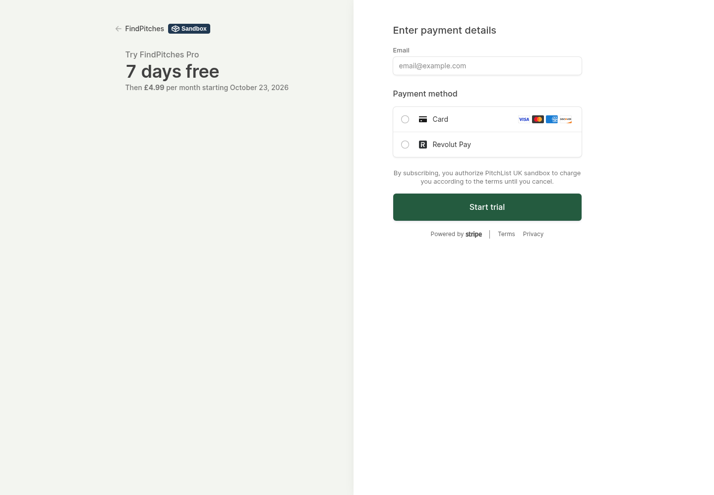

# FindPitches Checkout branding — 16 October 2026

**New hosted Checkouts now use FindPitches display name, cream background and dark green buttons.** Explicit V3 logo/icon URLs are accepted by Stripe and the exact owned PNGs are publicly verified. The hosted TEST layout displays the FindPitches name. Existing hosted sessions keep their original appearance/idempotency history.

The real signup and cancellation are also verified: a newly created V3-owned customer, completed £0 trial Checkout for the exact £4.99 global Pro product, seven-day trial and cancellation at trial end. Access remains valid through23October2026. Future actual expiry has not yet occurred; its fail-closed calculation is tested. [Sanitized owned acceptance](../operations/findpitches-v3/reports/owned-live-acceptance-2026-10-16.json). The screenshot's Link label and a new V3 customer record support the explanation that Stripe Link recognised saved payment/verification details; the customer's verified sign-in email is supplied to Stripe as designed.

## Checkout change and verification

The session sets V3 branding explicitly instead of altering the shared Stripe account. The existing approved Build4 mark and bundled Unbounded font produce the owned PNGs; a reproducible renderer is included. Hosted body font is Stripe's supported Inter. Only Checkout creation uses the documented2025-09-30.clover API contract. Canonical customer/subscription reads, webhook handling, ownership, global prices/entitlement, CSRF, trial eligibility, reservation/idempotency and cancellation recovery retain their existing contracts and safeguards.

The first hosted TEST exposed account-level Adaptive Pricing offering an automatic USD conversion/fee. The final request explicitly disables Adaptive Pricing so the selected GBP/USD/EUR price is retained. The final TEST displays **£4.99**, seven days free and the FindPitches styling without a conversion menu. No form or card details were submitted. Both temporary TEST sessions are expired. One new V3-owned TEST product/price remains available for repeatable tests; existing legacy TEST products were not edited. No LIVE test customer, Checkout, subscription or charge was created by engineering.

This is a Sandbox preview with empty synthetic placeholders. Its legal merchant disclosure still uses the shared Sandbox account name. The LIVE product and its approved price were independently proven by the real owned journey. Per-session colours/display name do not create a separate merchant account or rebrand the Portal, legal disclosure, card statement or every provider document.

## Release and checks

- Code commit **`db60244a`**; final customer version **`fc4eaef4-36a6-4de9-bf72-6643da9e6700`**, deployment **`0556cf5a-98b7-4b43-9418-81742e15200a`**. Public browsing/sign-in/account recovery and new Checkout are **on**.
- Full V3 **474 passed,0 failed/skipped**; frontend3, independence96 files, build58 files and runtime boundaries pass. Genuine hosted TEST/API checks pass, including fixed GBP pricing, visible FindPitches/green/cream and both accepted logo/icon URLs. No TLS bypass or reused customer browser profile.
- Public security/API/SEO **29/29 before and29/29 after** final reopening; native capability5/5. All native settings/bindings/secrets/schedules, routes/DNS, protected PitchList deployment, storage and existing cancellation were preserved. No migration or LIVE provider configuration edit.
- First activation check did not pass native state and automatically reclosed only new Checkout. Script ETag matched the tested bundle. Retry observed the old closed flag then live at the public endpoint, waited for native agreement, and passed all public checks. No account recovery interruption.
- Background source work was observed declining from89 outstanding to0, with a later small current work set (1 due/1 leased),0 dead/stale. Billing checks do not dispatch source jobs. Source paid0/bulkoff/manualpause, source publicationoff/rows0/0; no provenance/identity/acquisition control was changed. Source tables were not written; no new full custody audit is claimed.

[Sanitized deployment/test evidence](../operations/findpitches-v3/reports/checkout-branding-2026-10-16.json).

## Portal still requires the operator's direction

The hosted Portal remains on its dedicated FindPitches configuration and still inherits shared PitchList account branding. Stripe exposes no independent Portal colour/logo override on that configuration. The live PitchList service must remain protected, so no shared branding edit or new account/migration has been performed.

[Decision and implementation consequences](../team/STRIPE_BRANDING_DECISION_2026-10-16.md): separate FindPitches Stripe account (recommended for complete provider separation), own V3 billing management, or retain the Portal appearance temporarily. A session question requests the choice; no answer is assumed. A separate account must preserve the existing trial/history with explicit account-aware ownership and credentials rather than swapping the current key. Hal has not accepted an additional setup task yet.

Published source-custody note: the pre-push local currency fix `db60244a` was rebased onto hub updates as `7d458b22`; the implementation is identical. Subsequent native billing and performance releases retain that Checkout policy.
