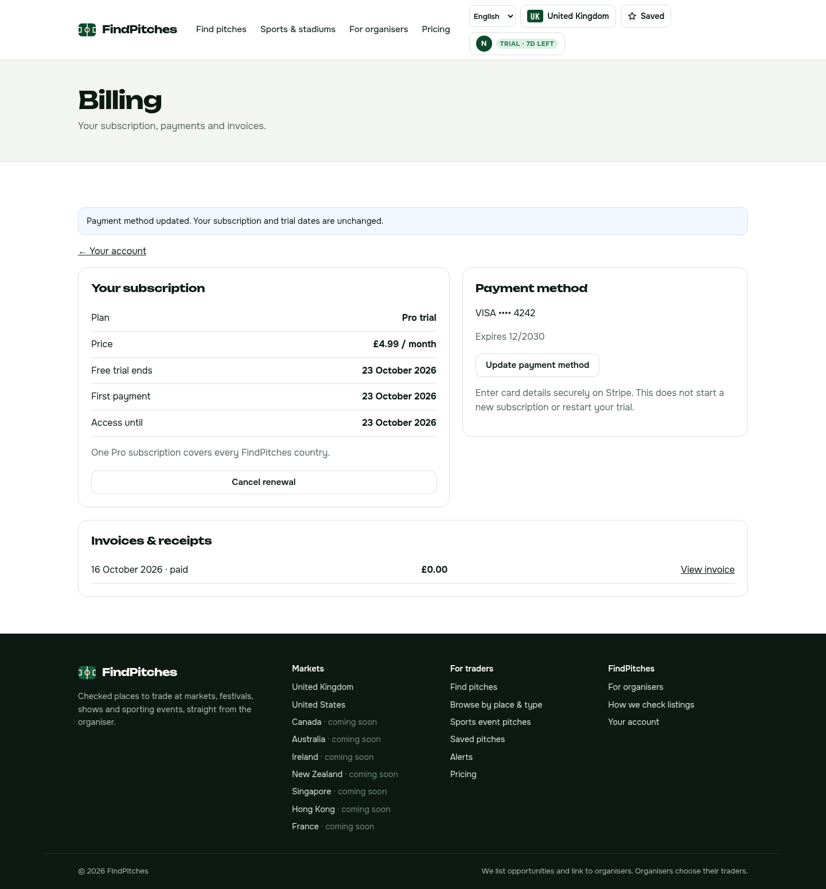

# Native FindPitches billing — 16 October 2026

**Live:** [findpitches.com/billing.html](https://findpitches.com/billing.html). Account → Manage billing now opens FindPitches-native management. It shows canonical plan/price, global entitlement, trial/renewal/access dates, cancellation, saved-card summary and owned invoices. Cancel renewal and resume remain on FindPitches. Card updates use the branded Stripe Checkout setup surface; V3 never collects card data. No new subscription/trial/charge is created by a payment update.

Chris's direction in [the native billing order](../team/FINDPITCHES_NATIVE_BILLING_PAGE_ORDER_2026-10-16.md) supersedes the earlier pending Portal/account choice. No new Stripe account, customer migration, shared branding or PitchList edit. The old dedicated Portal remains a recovery fallback. Stripe legal merchant/invoice branding is still account-level; native styling does not create merchant independence.

## Safeguards and acceptance

Canonical V3 customer metadata/email, subscription owner, exact global product/approved price and one-subscription rules precede management. Fresh ten-minute signed state prevents stale/forged actions; same-origin CSRF, per-customer limits, operation custody and Stripe idempotency protect changes/retries. Cancellation only sets cancel-at-period-end; resume removes it. Neither changes price/trial/end dates. Payment confirmation validates a stored owned session, completed setup, succeeded SetupIntent, attached owned card and matching metadata before updating only the validated subscription. Replayed/consumed or superseded older forms cannot replace a newer choice. No client-supplied owner/subscription/price/card ID is accepted.

Canonical provider failure fails closed. Optional invoice/card faults show unavailable and cannot block cancellation. The native page and account recovery remain independent of inventory/source availability and of new Checkout being enabled. EN/FR/DE are supported; signed-out users see a private sign-in gate, never billing details.

- **482/482 V3 tests**, frontend3, independence98 files, build60 files, boundaries pass.
- **38 local browser checks** across desktop/mobile and EN/FR/DE, using the real native Worker/SQLite with mocked Stripe. Includes native account navigation, cancel/resume, card-update return, private gate, no script/foreign requests/overflow.
- **Genuine Stripe TEST equivalent:** actual hosted card setup submitted only on Stripe, successful owned SetupIntent/attached card, clean intercepted FindPitches return before any production API call; direct TEST subscription payment-method update, cancel, resume and invoice receipt verified. Exact seven-day trial/period retained. Temporary TEST subscription cancelled; no LIVE object/action/charge or impersonation.
- Existing deployed LIVE card-read permission verified against the V3-owned card; SetupIntent/invoice read permissions verified with successful empty pre-epoch lists. Existing canonical capability5/5/product/three prices/global7-day/mail verification pass; no permission/key change needed.
- Public29/29 before and29/29 after Checkout restoration; six real-public anonymous browser combinations pass without TLS bypass. Existing Chris-owned LIVE signup/Portal cancellation is already proven separately; engineering did not mutate that LIVE subscription or claim a real native LIVE customer action.

## Deployment / storage custody

Code **268091bb**, final customer version **4e55c8e7-9350-4bfb-be1d-a996cb3c56db**, deployment **4eb0786b-63c6-4ee7-9110-a261b8db450d**. Public/sign-in/new Checkout/recovery on after guarded restoration at **19:10:27 London**. Native bindings/settings/secrets/schedules/routes/DNS and protected PitchList preserved. Full original source-custody audit was not repeated; no source tables, identities or producer/Pi code were written.

One additive V3-customer migration adds `billing_operations`, its index and ownership/immutability triggers. Existing schema hash unchanged; runtime schema version/owner mappings untouched. Existing customer/subscription counts1/1, pending webhooks0. Code release and Checkout restoration do not perform migrations themselves. Rollback is the previous customer bundle with the unused additive table retained, or the existing Portal fallback; no customer history deletion.

Source snapshot at19:09London: **1,836 READY** (US1664/GB162/NZ5/AU4/CA1). This background inventory change is not attributed to billing. Core6due/2leased,0dead/stale; paid0/off/manualpause, source-publicationoff/projection0/queue0. No Serper, alert send, source-publication or legacy change.

[Sanitized machine-readable evidence](../operations/findpitches-v3/reports/native-billing-2026-10-16.json). Next priority: measured V3-029 performance, then scheduled17/18October storage verdict, French proof and upcoming/Save under the consolidated order.
