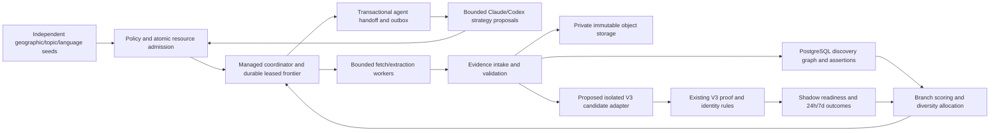

# Mycelium Phase 0 architecture review

**JOINT r2 architecture and £0-first addendum reviewed by Claude (§17–18). Original22–23Oct design retained; see24Oct priority below. Codex integrator; Claude discovery/worker contributor. No blanket implementation grant.**

Authority: [Phase 0 commission](../../team/MYCELIUM_PHASE0_COMMISSION_2026-10-22.md). Existing incidents follow [the operational queue](../../team/CURRENT_EXECUTION_ORDER.md). This is one proposed architecture, not a new product version or permission to implement it. No runtime/producer code, migration, infrastructure, external crawl, paid/model call or host install has been executed for this design.

**24 October priority supersession:** [Phase0.2 order](../../greenfield/docs/mycelium/PHASE_0_2_TASK_CONTRACT_AND_NOTIFICATIONS_2026-10-24.md) now governs the next task: agree a minimal GitHub-authoritative contract and separate approval-notification design. [Consolidated draft / Codex review](../../greenfield/docs/mycelium/PHASE_0_2_TASK_CONTRACT_REVIEW_2026-10-24.md) incorporates Claude's new proposal, with explicit amendments awaiting acknowledgement. The£0-first addendum below was accepted in Claude§18 (`e9403bbb`), so the old missing-review statement is superseded.

Host evidence now establishes a **manually initiated**23Oct native Codex→Claude→Codex proof (3calls/24s, subscription sign-ins; no output relay) and a separately approved hardened HubSync timer on J3455 (reported23.5h/252polls/0errors and power-cut recovery). HubSync launches **no AI**; subscription billing/capacity and automatic dispatch remain unproved.22Oct runtime/hardware observations below retain their dates, not current BRIX state. J1900 does no work and has a reported pre-OS restart issue. GitHub, not a home machine, holds current task/result/approval authority; PostgreSQL remains later graph/capacity research. No new CLI run, service change or notification is authorised by the current design review.

**Latest direction, received during the hosting research:** [Chris's £0-first gates](PHASE_0_COMMERCIAL_GATES_2026-10-22.md) supersede any implication that paid storage or metered API tests come next. Default incremental experimentation spend is **£0**. First establish a permitted subscription CLI Codex→Claude review→Codex reconciliation without human response relay, then source-proved discovery improvement and reliability/cost evidence. Each execution stage needs explicit approval. Older£75/£5/£10 envelopes below are unspent proposals for possible later approval, never grants or automatic fallbacks. Claude accepted r2 before these new gates; he is asked to review this sequencing addendum explicitly.

**Review provenance:** Codex has read all of [Claude's contribution](CLAUDE_DISCOVERY_DESIGN.md), including interface answers in §14, his cross-review of r1 (`302eb89a`) in §15 (`75eadffd`), and the subsequent BRIX profiles in §16 (`d987a8ee`). This revision incorporates that input, the [consolidation order](../../team/MYCELIUM_CODEX_CONSOLIDATION_ORDER_2026-10-22.md) and [Chris's BRIX allocation](../../team/MYCELIUM_BRIX_ALLOCATION_2026-10-22.md). Claude subsequently reviewed r2 in full and accepted every reconciliation with no blocking disagreement in §17 (`1c4534c3`, 22Oct15:30London). Both authors therefore acknowledge this one architecture. His three non-blocking notes concern a higher CPU benchmark point within the same slice, previously evidenced idle sensors, and privately transferred retained-page fixtures. These are later benchmark considerations, not an execution grant. His contribution remains his own record.

## 1. Executive recommendation and reuse versus build

Recommend **a separately isolated discovery service using managed PostgreSQL and private content-addressed object storage**, with ordinary relational edges first. Benchmark it before selecting a provider. Keep existing V3 D1/R2, verification, customer reads, sign-in and billing in place. Mycelium proposes where to investigate; V3 remains the authority on identity, source facts and actionable opportunity eligibility.

The commercial hypothesis is that several bounded exploration methods, independent new seeds and measured branch feedback will find more **genuinely new event editions still verified and actionable at24h/7d per £ and worker-hour**, after withdrawals. More links, application variants or model conversations do not validate the hypothesis. A new recurring date exists only when the source proves a distinct occurrence; an inferred calendar expansion earns no credit.

**Three prerequisites:** reliable producer progress independent of transport heartbeats; benchmarked storage/lease recovery under realistic fan-out; and an executed unattended two-runtime handoff. None follows from writing this document. The 21–22 October freshness incident is **resolved on host evidence**, reported by Claude/Chris: the acquire timer was left inactive during the kit install/rebuild, re-enabled at12:30London22Oct; installed kit012a completed a cycle/export at13:31–13:32London, rc=0. Cloud read-only confirmation at **14:29London22Oct** found fresh receipts/imports through13:42London, latest actual source check13:30:46London, cadence/freshness passing and producer rechecks1068, down from1126 at12:25. This verifies resumed delivery, not every deferred recheck or the future timer-restoration fix. Kit identity comes from host evidence, not a cloud attestation.

The same14:29 customer-proof snapshot contains **1708 READY: GB205/US1492/FR1/AU4/NZ5/CA1**, core queues clear, original CJS47 currently READY. The earlier proof-interval audit covered the entire first24h for46/47, with one expiry gap; recovery now does not erase that gap or supply an exact-time historical customer snapshot. One gain/one withdrawal since12:25 is not evidence of a new event edition. Existing paid/bulk acquisition and source publication remain off; existing public FindPitches/Checkout settings are unchanged. These operational reads used the private staging catalogue and delivery/job/policy tables, with raw results outside Git. They did not change production code or start Mycelium.

| Reuse as a boundary/reference | Build only after approval | Do not replace |
|---|---|---|
| V3 immutable receipts, source clocks, identity decisions, verifier/readiness code, failure vocabulary and 100-row preservation control | Bounded discovery-candidate adapter with its own low-authority producer namespace and outcome interface | Existing customer/D1/R2 data, billing, public routes, V1/V2 |
| Producer parsers, country packs, safe source policies, retained evidence and export compatibility | Optional worker adapter to the coordinator; independent new-seed hypotheses and explicit relationships | Independent producer's `fdx1` identities or its current HTTPS delivery |
| Durable-job/fencing/outbox principles; existing Cloudflare queue infrastructure patterns | PostgreSQL discovery schema, branch/budget coordinator and configured unattended agent runners | Treating GitHub Markdown or ChatGPT as an automatic controller |
| Existing immutable experiment receipts and country/source scorecards | Delayed event-edition rewards, fair control allocation and cost/retention ledger | Counting new application IDs as new festivals |

**Why this candidate:** Postgres handles transactions, unique constraints, bounded graph joins and leases in one managed system. Objects keep large source bodies out of expensive relational indexes. D1 remains suitable for current V3; increasing its role to a globally expanding discovery graph would repeat the known capacity problem. A dedicated graph service is a fallback for measured traversal/analytics failures, not a prerequisite. Home hardware may provide bounded compute, never the sole authoritative database. If the bounded trial cannot improve retained-new-event yield over simpler source/verification improvements, reject the extra graph/coordinator rather than fund architectural novelty.

The [commissioned hosting memo](../../greenfield/docs/mycelium/HOSTING_COST_REVIEW_2026-10-22.md) now provides dated public prices/limits and25/100/250GB scenarios. It recommends a conditional Neon London short-test candidate and compares DO/Aiven/Supabase/VPS for steady operation. No Mycelium database bottleneck has yet been observed because the service is not running. New spending needs the actual bottleneck, no-cost attempts, full recurring/variable costs and projected commercial value before a specific approval request. A plausible storage model alone is insufficient.

### Evidence inspected and limits

- [V3 source architecture](../findpitches-v3-architecture.md), [Worker routes](../../platform/findpitches-v3/worker.mjs), [producer authorities/normalisation](../../platform/findpitches-v3/contract.mjs), [verification and source clocks](../../platform/findpitches-v3/verification-store.mjs), [proof expiry/backoff](../../platform/findpitches-v3/source-renewal.mjs), [durable jobs](../../platform/findpitches-v3/jobs.mjs), and [source catalogue](../../platform/findpitches-v3/source-catalogue.mjs).
- [Producer ownership](../../producer/README.md), [frontier/assessment schema](../../producer/fp-discovery-lab/fpd/db.py), [exploration](../../producer/fp-discovery-lab/fpd/explore.py), [identity algorithm](../../producer/fp-discovery-lab/fpd/integration/identity.py), [export schema](../../producer/fp-discovery-lab/fpd/integration/schema.py), [cycle](../../producer/fp-discovery-lab/deploy/pi/bin/fpd-cycle), [systemd limits](../../producer/fp-discovery-lab/deploy/pi/systemd/fpd-acquire.service).
- Claude's [UK yield](../findpitches-v3-uk-producer-yield-2026-10-21.md):15648 weekly source pages, France52% of fetches for one then-READY, UK-specific generators about6%;232 delivered GB current IDs. Subsequent [cloud conversion](../findpitches-v3-localstalls-conversion-2026-10-21.md):8/232 producer IDs customer-ready. Different units/windows; neither is an intrinsic permanent source yield.
- Claude's [full contribution and r1 cross-review](CLAUDE_DISCOVERY_DESIGN.md): reusable source strategies S1–S7, host-reported450MB Pi cgroup/up to four different-host fetches, export/worker contract, V3-access gate and exact standing/edition attribution. Claude has no direct host shell; host observations were supplied by Chris. His older C2 language question is withdrawn in §15; FR, not DE, is the non-English pilot sample. The later BRIX allocation order supersedes ownership being an open question, not the need for benchmark/install approval.
- [US learning](../findpitches-v3-us-learning-map-readiness-2026-10-14.md):68 source-proved entity gains but only two net new exact event groups; recent-window yield decayed and the arm stopped. The current official-operator extractor's zero platform leaves was not proof of zero opportunities.
- [Storage profile](../findpitches-v3-storage-plan-2026-10-14.md):7.91GB source documents in a9.63GB D1; [verified tiering](../findpitches-v3-storage-completion-2026-10-15.md) restored headroom without a rebuild. Later measured48h net D1 growth was114.5MB/day ([21Oct evidence](../../operations/findpitches-v3/reports/uk-growth-outcome-2026-10-21.json)). This is not a Postgres benchmark or a forecast of Mycelium savings.
- No Postgres deployment/query benchmark, provider quote, unattended Claude/Codex API round trip or current Pi shell measurement was performed. Calculations below are explicit planning assumptions.

## 2. End-to-end architecture

Objects are evidence, Postgres is discovery/control authority, V3 is eligibility authority. Transport queues wake a durable job; they do not own its state. No diagram arrow grants access to customer/billing data or enables publication. The experiment has no path into public customer reads.

**Two different branching operations:** workers discover event→organiser→venue→programme→application links with witnessed relationships; a bounded planner also proposes independent seed hypotheses from approved geographic/topic rosters and permitted strategy templates. Empty link-following must not halt discovery of new roots. Source text is untrusted data, never an instruction to invoke tools, change budgets or execute code. A model can propose a template instance, not deploy crawler code or grant a new credential/country/source policy.

**Adopted discovery catalogue — Claude S1–S7, one scheduler and one experiment:**

| Strategy | Seed/relationship and pilot treatment |
|---|---|
| S1 application platforms | Known event/application populations, restricted to policy-approved families V3 can verify. LocalStalls is eligible for reviewed event routes, not automatically READY; UKCraftFairs is parked. |
| S2 open registries | Approved open entity/geographic rosters → official actor websites. Seeds only; directory rows never prove an event or trader route. Dataset terms/licence/rate limits need review. |
| S3 authorities/calendars | Independent authority rosters → official markets/trader calls and their forms/PDFs. An official directory supplies leads, not inherited trust in every linked event. |
| S4 organiser/venue graph walk | Seed only from verified organiser/venue nodes behind V3 READY; follow witnessed other-event/edition/partner links. Child claims require their own proof. |
| S5 edition/standing-market watch | Existing explicitly recurring records → source-stated next editions/openings. No synthetic calendar expansion, standing-ID rewrite or reward for another form on the same edition. |
| S6 archive-index patterns | **Excluded by default.** Index terms/access/rate review and explicit approval are prerequisites. If later admitted, it is a separately attributed branch inside the same remaining experiment budget, not another experiment or budget. |
| S7 independent hypotheses | Deterministic country × language × event/authority templates over approved rosters and coverage gaps. Proposed new branches get parent/reason/policy/budget/kill rules. A model proposer is optional and separately funded; autonomous rule-based new-root proposals do not require one. |

Initial emphasis is S3/S4/S5 and verified-capability S1, with bounded S2/S7 exploration so link-following cannot exhaust all roots. English/GB75% and French/FR25% acquisition allocation is adopted from Claude's §15 agreement; German stays out. Source and runtime grants remain prerequisites. Social/editorial/visitor-ticket pages and platform index shells are excluded as pilot acquisition targets and never supply proof. More countries/languages require supported export/verification semantics and a new grant.

## 3. Common knowledge, evidence and handoff contract

### Data model and identity

| Relation | Required content and invariants | Interface owner |
|---|---|---|
| `subject`, `subject_alias` | UUID; type=actor/venue/event-series/edition/occurrence/application-route/document; literal names/language and namespace+native ID anchors. Aliases are claims with evidence, not merges. | Codex integrates; Claude supplies source anchors |
| `edition`, `occurrence`, `application_route` | Series relation; explicitly evidenced edition/date/session; source-specific native identity; separately typed route/state/deadline. UNKNOWN is permitted. A standing market listing is not automatically one dated edition or infinitely many occurrences. | Codex/V3 identity; Claude extracts evidence |
| `lead` | Exact URL/canonicalisation version, origin, registrable domain, language/country/topic **hints**, first/last observations, branch membership and policy disposition. Semantic query IDs retained; URL hash uniqueness is not real-event dedupe. | Claude worker contract; Codex schema |
| `edge`, `edge_evidence` | Typed directed relation, endpoints, source receipt/span, extraction version, confidence/uncertainty and validity observations. Includes discovers/organises/hosts/occurs-at/applies-via and possible-same-edition. Parent hypothesis may be an independent seed root. | Shared vocabulary; Codex arbitration |
| `assertion` | Append-only subject/predicate/value, original language, evidence receipt/span, parser version and source clock. Supersession is a new assertion with reason/parent; no destructive fact repair. | Codex custody; Claude extraction |
| `artifact`, `fetch_receipt` | Private object reference, raw-body SHA-256, envelope SHA-256, length, compression, media type, requested/final URL, access-policy version, actual fetched_at/status/redirect chain and fetch actor. One identical body can back several new immutable receipts. | Codex intake |
| `hypothesis`, `branch_event` | Root/parent, strategy+version, exact reason/evidence, country/language/topic scope, access policy, budgets, status, outcome and reopen condition. Append-only state-transition events. | Claude strategies; Codex state machine |
| `job`, `attempt`, `handoff`, `outbox`, `budget_reservation` | Deterministic idempotency key, dependencies, capability, fencing token, lease/deadline, resource grant and immutable result digest/attempt costs. | Codex coordinator |
| `v3_link`, `outcome_observation`, `experiment_assignment` | Immutable bridge request, producer ID, V3 entity/edition decision, proof revision/policy, actual READY/held/withdrawn observation and country/source attribution; root/arm/cost lineage. | Codex V3 and measurement |

V3's stable `ent_` identity and original producer `fdx1` IDs remain authoritative in their own namespaces. Mycelium graph IDs never replace them. A URL, translated name, same venue, shared form or model-suggested year cannot merge editions. Keep possible matches as edges until V3 makes an explicit identity decision. Several vendor forms for the same edition share one primary reward; distinct occurrence/edition evidence may earn a separate reward. Date/geography hints are never promoted to verified fields.

**Standing-market reconciliation, agreed with Claude §15:** preserve the original `fdx1` programme identity and all source-listed dates. A genuinely new standing programme earns primary credit once when first verified; explicitly source-listed distinct occurrences may earn separate occurrence credit, reported separately from edition/series totals so they cannot inflate the headline event count. A revisit, added date range, copied listing or generated recurring date is not new identity. V3 records every series↔edition↔occurrence decision; unresolved mappings earn no new-event reward. Keep separate ledgers for new series, new editions and explicit occurrences, never sum different identity levels for the same event into one KPI.

Raw source bytes and serialised custody envelopes have **different hash domains**; carry both algorithms/serialization versions explicitly. Existing R2 objects use the original serialized-document digest and clocks; do not reinterpret those keys as HTML-body hashes. New screenshots/PDFs are bounded byte objects with provenance, not scraped customer data. Do not copy whole source excerpts into every edge or job.

### Bounded worker and agent messages

A versioned request carries schema version; experiment/root/parent/branch/job/attempt IDs; required capability and strategy version; immutable input refs/digests; policy grant; allowed hosts/country-language hypotheses; redirect/depth/child/byte limits; HTTP/CPU/wall/model-token/cost ceilings; lease token+generation; deadline; expected output schema and callback audience. A result carries those correlations, original observations/evidence refs, proposed edges/assertions, errors/access refusals, proposed children, actual resource usage, result digest and partial/completed/uncertain disposition. No private API token, raw cookie, sign-in URL or customer email belongs in either message.

Same job key+same input/config/result digest replays idempotently. Same key+different payload is a conflict, not a silent update. Record lost responses and unknown provider spend; do not refund a reservation or blindly invoke a model again. Schema major versions reject incompatibility; parsers and hypothesis versions are explicit so replay does not masquerade as a fresh fetch. Claimed timestamps are checked against broker receipts and future clocks are rejected.

**Claude worker mapping, integrated rather than a second protocol:**

| Claude proposal | Common contract / decision |
|---|---|
| Task `kind`, URL/seed, branch, budget, policy | `job.kind`=fetch/expand/reassess/refresh/census plus the request fields above; mandatory lease generation/token, immutable input digests and declared output version. One task may contain a bounded fetch bundle, never unlimited expansion. |
| `fetches`, `assessments`, `edges`, `candidates`, `new_leads`, `errors`, `budget_used` | `fetch_receipt`+`artifact`, append-only `assertion`, `edge`/`edge_evidence`, `lead` plus original export payload, proposed child jobs, typed refusals and measured usage. A partial result may store evidence but cannot claim a complete job or READY. |
| Existing v1 export, `fdx1` and `last_checked` | Preserve the original v1 payload/anchors/source clocks byte-for-byte as retained evidence. Put branch lineage, object/body hashes, worker/classifier versions and audit labels in a versioned **sidecar envelope**; validate extensions explicitly, rather than inserting unknown fields into the current v1 schema. No-fetch reassessment never advances `last_checked`. |
| Result dedupe `(task_id, content_sha256)` | Deduplicate the full accepted result by job/input/config/result digest plus fencing; body hash deduplicates objects only. Different clocks/assessments are distinct receipts even for the same HTML. Late-attempt evidence is not authority to replace a settled result. |
| Worker heartbeat60s | Adopt coordinator30s heartbeat/5min lease as the common proposal; Claude §15 accepts the state-machine names. Heartbeat loss fences work; ambiguous external spend goes to SPEND_UNCERTAIN, not a blind retry. |

### Outcome and access interfaces — proposed, not deployed

Codex owns a scoped, paginated **dispositions feed** at least daily and at experiment checkpoints, following the existing per-ID report. Each observation carries producer namespace/original ID, immutable receipt/source clock, V3 entity/series/edition/occurrence links and identity-decision reference, observed READY/held/withdrawn state/reason codes, verifier/policy revision, effective transition time **when actually recorded**, observation time, branch/arm correlation and sequence/watermark. Replay after a cursor is idempotent; unavailable historical first-READY/withdrawal times remain UNKNOWN. A current daily snapshot cannot establish continuous availability or invent past transitions. New experiments capture transitions plus24h/7d observations from inception.

Codex also owns the versioned **V3 capability map**: source domain/platform, market/route/adapter scope, source-policy decision, verifier version, last legitimate success, recent access-failure numerator/denominator/window, hold reason and next permitted capability review. A fetchable homepage is not a supported vendor-route verifier. Workers consume these read-only snapshots, not customer data or operator tokens. Unknown capability permits only a separately reserved, policy-approved bounded qualification check; it is no licence for acquisition. Global denied-domain state applies across every strategy/worker.

The coordinator API owns scoped claim/heartbeat/complete/settle, branch proposals, dead-letter/reopen and stop grants. Claude owns the worker/extractor/packs/export side; Codex owns persistence, API validation and outcomes. Disposition/capability publication is a future approved interface, not an extra scheduled report being installed now.

### Existing V3 API compatibility — a real gap

`POST /imports` currently **hard-codes `independent-structured`**, whose authority is100. `GET /rechecks` and exact-request `/rechecks/ack` belong to that scoped producer contract. Reusing its token/IDs for speculative Mycelium output would launder weak leads into the strongest lane and is rejected. The current catalogue discovery endpoints are operator-only and support bounded known platforms; they are not a general graph intake. Source-document upload OptionB remains off.

**Proposed later interface, not an existing route:** a separate authenticated discovery-candidate adapter, with Mycelium-only scope/ID namespace and no more than discovery authority50, validates provenance/idempotency and returns accepted/duplicate/held/rejected plus a durable receipt—not READY. Preserve Claude's original v1 export and original producer/`fdx1` identity inside the custody envelope; the outer Mycelium submission ID identifies this low-authority delivery and does not impersonate `independent-structured`. Shared anchors become proposed links for V3's explicit identity decision, never implicit authority100. Unknown or unsupported fields stay absent/held. V3's own direct-source verifier may then add stronger evidence under its normal rules; identity/country/date conflicts and original source selections remain protected. Unsupported source families stay WATCH, even if Mycelium extracted plausible facts.

Codex owns adapter/eligibility policy and an outcome read interface; Claude owns compatible worker/export metadata. Original Pi delivery remains logically independent and unchanged. The adapter requires future approved implementation and explicit isolation before it can receive anything. For the experiment, use V3 verifier/readiness code in an isolated test store with publication disabled and customer reads technically unable to include experiment IDs. Never rely on a client-provided shadow flag or accidentally import experimental records into today's public commercial scope.

## 4. PostgreSQL/object-store design and storage benchmark

### Physical design and operational constraints

Use a separate managed Postgres project/schema and a private Mycelium object prefix/bucket with distinct credentials; no existing V3 migration, table replacement or copy. Relational typed edges first. UUIDs identify internal rows; unique constraints cover namespace+native anchor, canonical URL hash+normaliser version, artifact digest, job dedupe key, and handoff result digest. Keep long URLs/labels in their owning row, not repeated in every edge. JSONB is for bounded extra attributes (target≤32KB), not raw pages or an unindexed graph dump.

Indexes: both `(from_subject, relation, to_subject)` and reverse edges; `(namespace, native_id)` anchors; unique canonical-hash lead index; branch/root/time outcome indexes; partial queued-job `(capability, available_at, priority, id)` and leased-job expiry indexes; per-domain cooldown/admission; object digest lookup. Do not index arbitrary JSON properties or personal contact text. Edge evidence has its own compact many-to-many references rather than repeating raw bodies.

Time-partition append-heavy attempt/fetch/outcome audit by month; keep frontier leases, budget counters and the global job/result/digest uniqueness registries small and unpartitioned initially. Do not assume a partition-local unique index enforces cross-partition idempotency; partition references carry their time key. Stable subjects/edges are not country-sharded: country can be disputed, and organisers cross borders. Benchmark hash partitioning the largest adjacency table only if its indexes/maintenance warrant it. Use short transactions for conditional lease claims and result+outbox+cost settlement, with `SKIP LOCKED`/fencing semantics; fetches/model calls never run while a database transaction is open. Autovacuum, dead tuples, WAL volume, index growth and replication lag are acceptance metrics, not hidden overhead.

Proposed pools:≤16 ordinary active DB connections initially, separate reserved operational connections; workers access scoped broker endpoints, not broad SQL credentials. **Pi measured envelope, via Chris/Claude:** one task at a time, up to **four in-flight fetches to different hosts inside that task**, in the actual450MB crawl cgroup; one concurrent request/domain and≥2s delay still apply. Repository defaults (550MB MemoryHigh/700MB MemoryMax, generic concurrency16,2h cycle timeout) are not current host measurements. The existing Pi producer operates independently; this design does not install a second consumer there or take its memory/CPU for Mycelium. No browser-heavy or local model inference assumption. Cloud managed storage remains authoritative if every home worker disappears.

### BRIX allocation and proposed benchmark profiles

**Allocation is decided:** Chris has dedicated both8GB/SSD machines exclusively to Mycelium, not existing V3 producer throughput. The J3455 and J1900 are currently **powered off on his bench**, intended for a home-network move. Allocation/planning permission does not establish current access, installation, uptime or permission to run tests. Their RAM is not subject to the Pi's450MB cap. Claude owns worker/profile design; Codex integrates coordinator/admission constraints.

**Prior host facts, supplied by Chris on21Oct and documented in Claude §16:** both four-core Debian13 machines; Linux saw7.6GiB J3455/7.7GiB J1900; both120GB SSDs. J3455 ADATA SU650 reported100%life/~0.35TB written, idle37°C; J1900 Kingston A400 ~84%life/~6.5TB written, idle42°C. Watchdog/cgroups/keys/clock-sync/restore-on-power and new CMOS batteries are reported configured. These are prior inventory/idle observations, not current online status or a load/thermal/throughput benchmark. Revalidate at the approved home install.

Adopt Claude's **§16 worker profiles**, with an explicit initial conservative ramp and slice accounting. J3455 is primary fetch/extraction; J1900 also runs stored-evidence reassessment/regression and can take over fetching. The following are proposals, not installed limits or measured throughput:

| Per-host service/limit | BRIX J3455,8GB | BRIX J1900,8GB |
|---|---|---|
| Fetch/extraction worker | One task with one fetch/control process + up to2 extraction processes; **whole worker** MemoryHigh3GiB/MemoryMax4GiB; CPUQuota150% initially | One task with one fetch/control + up to2 extraction processes; whole worker MemoryHigh2.5GiB/MemoryMax3.5GiB; CPUQuota100% initially; third extractor only in approved reassessment profile |
| Fetches within task | Start4 different-host in-flight, ceiling8 after benchmark | Start2 different-host in-flight, ceiling6 after benchmark; no copying J3455 throughput assumption |
| Optional scoped broker-client sidecar | MemoryHigh128MiB/MemoryMax256MiB; no broad SQL/operator key | Same, separately isolated from worker |
| Watchdog/telemetry process | MemoryHigh32MiB/MemoryMax64MiB; bounded logs | Same |
| Whole Mycelium service slice | Hard memory≤4.5GiB including worker/sidecar/watchdog; no local model/browser pool | Hard memory≤4GiB including all services; reserves are not permission for another worker |
| Host reserve/I/O | Reserve≥2GiB for OS/cache/overhead; low-priority I/O/nice10; local LRU≤30GB; SSD writes≤30GB/day; keep≥max(15GB,20%SSD) free | Same OS/free-space/I/O safeguards; LRU≤20GB and writes≤15GB/day to protect older SSD |

Profile data must include actual usable RAM/SSD/free space, OS/cgroup version, CPU throttling, temperatures, load, memory.current/peak/events, RSS, I/O latency, write bytes and bounded-fixture pages/s. No swap-thrashing-based throughput claim. Adopt Claude's stop-claiming rules:5min load>3.5, RSS/cgroup usage atMemoryHigh, unsent outbox>200, disk reserve/write budget breached, temperature≥80°C (or within10°C of documented throttle limit if lower). Add host available memory<2GiB and the queue/proof thresholds in §7. Do not increase concurrency above75°C or within15°C of throttle. Settle/fail bounded tasks safely; resume only after pressure resolves, outbox≤100 and a5min stable below-threshold interval. Sensor/limit availability is a prerequisite; no reliable sensor means no concurrency escalation or unattended soak. A clock offset>5s pauses lease-taking until corrected; use broker time/monotonic durations, not battery-clock trust. These are design limits, not observed load results.

**Benchmark-only use is proposed as a separately approved substage of0A**, with the no-network fixture protocol in §8. Actual remote access/install method and worker packaging remain engineering questions; Claude currently has no host shell. Chris may later install a reviewed bounded kit, or approve a scoped access mechanism; neither has happened under this design. No Mycelium database, paid model runtime or autonomous crawler belongs on either host by default.

### Explicit size model — estimates, not benchmarks

All GB/KB here are decimal. Let **L=retained URL leads**, not events. Base distribution per lead:

| Component | Assumed rows and mean attributed bytes | Logical bytes/lead |
|---|---|---:|
| Typed subjects | 1.5 ×512 | 768 |
| Lead metadata | 1 ×640 | 640 |
| Evidence-bound edges | 8 ×192 | 1536 |
| Compact assertions | 4 ×256 | 1024 |
| Representative fetch receipts | 2 ×224 | 448 |
| Artifact metadata | 1 ×256 | 256 |
| Compact job/outcome summaries | 0.5 ×256 | 128 |
| **Total** | Excludes source bodies | **4800** |

Assume **2× logical size** for heap/index/tuple/bloat allocation, to be replaced by measured `pg_total_relation_size`, and working disk≥1.5× that live size+5GB. Peak bulk-load WAL, backups, free space and replicas are additional provider constraints. Objects assume0.65 unique bodies/lead at60KB compressed, i.e.67.5% identical-body reuse across two receipts; this is a hypothesis, not measured compression/dedupe. Positive-proof history and repeated changes can exceed it.

| Retained leads | Subjects / edges | Logical PG | Modelled live PG | Candidate working disk | Primary objects |
|---:|---:|---:|---:|---:|---:|
| 100k | 150k /800k | 0.48GB | 0.96GB | ≥20GB provider floor | 3.9GB |
| 1m | 1.5m /8m | 4.8GB | 9.6GB | ≥20GB | 39GB |
| 10m | 15m /80m | 48GB | 96GB | ≥160GB | 390GB |

Sensitivity matters more than the neat base table. A3× instead of2× relational overhead makes the10m case144GB PG and at least221GB working disk before provider-specific limits. At10m leads,24 rather than8 edges adds **61.44GB PG** at the base overhead; eight rather than four assertions adds20.48GB. Three distinct200KB object versions/lead produce **6TB**, not390GB. At10k new leads/day, the base adds96MB PG and390MB primary objects/day before revisits/retention. Those numbers do not predict new READY or savings in existing D1. Log/attempt volume depends on fetch frequency, not just unique leads, so benchmark a separate10×-revisit case and a100k-edge hub.

### Retention, privacy and recovery

Proposed **new-service** policy for review: detailed transient fetch/worker logs14d; successful operational attempts30d; compact experiment/budget/outcome ledgers≥180d; deduplicated unqualified page bodies90d; small refusal/error bodies7d where permitted; durable discovery keys and compact claims retained until a reviewed archive policy applies. Keep every original evidence object relied on by an accepted V3 decision beyond those TTLs; GC must prove no proof/retention/legal-hold reference before removing anything. Repeated identical fetches add clocks/status, not another body. These policies do not delete, shorten retention or change existing V3 evidence, and deletion tooling is not authorised now.

Private encryption/access logs; no tokens/cookies/private attendee data/form submissions; minimise trader contact data and restrict access where a source necessarily publishes it. No cross-tenant content-addressed access/dedup without separate ACL ownership. Policy refusals and robots snapshots are durable small records so another agent cannot rediscover a blocked path as a novel strategy. Rights/deletion and legal-hold exceptions require a defined owner before launch.

Managed daily database snapshots+PITR7d (initial targets: RPO≤15min, RTO≤4h), plus approved separate-failure-domain backup of graph manifests and referenced immutable objects. Object-store durability is not a backup policy. A restore drill must validate all referenced hashes, retain grant/spend history and start dispatch OFF. Old leases/fencing generations and queued outbox delivery are invalidated before resuming, so restore cannot repeat model charges or page acquisition. Object version/lifecycle policies and backup egress costs need approval; no deletes or restore drills occur in Phase0.

### Cost ranges and database alternative

**Planning rates only, not current quotes:** PG provisioned storage£0.15–0.40/GB-month, backup£0.03–0.10/GB-month, object storage£0.01–0.03/GB-month/copy; request charges and cross-cloud egress may dominate repeated downloads. Assume an additional object backup copy and approximately2× live-PG backup bytes. Example provisioned compute/coordinator envelopes yield:

| Scale | Proposed compute / coordinator monthly allowance | Indicative service total/month |
|---|---:|---:|
| 100k | PG£40–100; coordinator£5–20 | about£50–130 |
| 1m | PG£90–220; coordinator£5–20 | about£100–260 |
| 10m | PG£250–700; coordinator£10–40 | about£300–850 |

Totals include the modelled disk/backup/object ranges, **exclude HA duplication, model/search, human review, large bandwidth/request bills and taxes**, and are not spending permission. Provider included storage/backups must not be double counted. Quote minimum billing, PITR/WAL, connection pooling, cold-start/fixed versus metered CPU, object GET/PUT, cross-region egress and caps before selection. If HA or10× revisit sensitivity exceeds the approved envelope, stop/re-scope rather than silently autoscale.

For provider decisions use the newer [hosting memo's verified-rate calculations](../../greenfield/docs/mycelium/HOSTING_COST_REVIEW_2026-10-22.md), including recovery/HA differences, rather than treating this generic allowance as a quote. Free plans cannot support25GB; smaller synthetic calibration may be possible within confirmed free quotas. The current incremental grant remains£0.

Model cost is separately visible: even one call/100 leads at an illustrative£0.02–0.20/call is£20–200 per100k leads and£2000–20000 per10m over the processing horizon, before any READY return. Those are assumed unit costs, not model quotes. Deterministic parsing/feedback first; scarce models plan/review branches or uncertain cases. Actual pinned-model token prices/FX and conservative reservations are required before any call.

**Postgres failure boundary:** high-degree hub expansion, hot global counters, large unbounded recursive paths, write-heavy evidence history, WAL/autovacuum/I/O churn or indexes exceeding memory can defeat the model. Cap traversals and per-domain work, measure amplification, and aggregate offline first. Consider a dedicated managed graph/analytics service only if representative bounded queries still fail after justified indexing/partitioning, or recurring deep traversals/community analytics become essential. Benchmark the same workload and full operational cost then; do not select it based solely on an edge-count threshold. SQLite on home hardware is a local cache, never the shared authority; D1 remains the current V3 boundary.

## 5. Real agent runtimes and durable coordinator

### What is actually available

| Component | Evidence now | Missing before unattended claims |
|---|---|---|
| Interactive Codex environment | Read-only22Oct check: `codex-cli 0.159.0-alpha.3`; `codex exec --help` succeeds, no model invoked | Native non-interactive command exists, but eligible subscription auth, actual billing/quota route, trigger, isolation and cross-agent callback remain unproved. Existing chat access is not machine-login evidence. |
| Claude Cowork / native CLI | Human-invoked contribution; Git push403 reported, hub via Chris's sync script. `claude` executable **absent** in this cloud workspace | Native CLI installation/auth/terms route and unattended runner unproved; no Pi/BRIX shell. No credential, automatic cost mode or end-to-end test assumed from Cowork. |
| Pi services | Host-reported012a/timer restart and completed cycle; cloud resumed imports/source freshness confirmed22Oct14:29London | Future real-progress telemetry contract, timer-restore-on-exit fix and deferred recheck drain remain separate producer work. Polling alone is neither successful acquisition nor a model-agent runtime. |
| BRIX | Both8GB/SSD units allocated to Mycelium; currently powered off per Chris | Approved benchmark/install/access, enforced per-host profiles, current clocks/resources/thermal/soak evidence; no services assumed running |
| Managed coordinator + Postgres | Proposed only | Approved provider, service credentials, event ingress, alarms/stop operator and executed recovery tests |

ChatGPT remains coordination/review; Hal provider configuration only if separately requested. Neither is a processing worker. GitHub is the human review/audit hub, not the hot queue. No new GitHub Actions, cron, notification bot, model key or automated agent is installed for this review.

Recommend a small managed coordinator colocated with Postgres for short transactions, with an outbox feeding an approved queue/HTTP wakeup transport. Reuse Cloudflare queue semantics where justified, rather than adopting a new queue product by default; a Worker-to-PG pooler/HTTP bridge must be benchmarked if chosen. Cloudflare's existing V3 queues/secrets are not automatically granted to this new service. Workers and two agent runners use separate short-lived scoped credentials/audiences, not shared operator or ingest credentials.

### State, claims and retries

| State | Admission/transition rule |
|---|---|
| PROPOSED | Parent/reason/evidence and immutable input exist; no I/O permitted |
| POLICY_BLOCKED / AWAITING_APPROVAL | Explicit access, credential, new scope, quota or human gate; model cannot override |
| QUEUED | Policy/grant valid; reserve worst-case request/byte/time/token/cost budgets atomically across job/root/run/hour/day/provider |
| LEASED / RUNNING | Single conditional claim increments fencing generation;5min lease,30s heartbeat, bounded hard deadline; target≤10min/job, smaller fetch tasks |
| WAITING_DEPENDENCY | Explicit DAG; max dependency depth8, no cycles; no long-lived held transaction or lease while waiting for another agent |
| RESULT_RECORDED | Validate input/version/fence/result digest; evidence complete; atomically persist result/outcome/cost/outbox |
| SETTLED | Durable acknowledgement; duplicate wakeup returns prior receipt without repeating work |
| RETRY_AT / DEAD | Up to3 bounded attempts with jitter/backoff; respect source Retry-After and negative policy cache; dead requires a recorded review/reopen event |
| SPEND_UNCERTAIN | Provider request may have run but outcome/bill is unknown; retain reservation, stop repeat invocation until provider reconciliation/operator review |
| PAUSED / PRUNED | Reason, evidence, budget spent, next eligible review condition; no identity/evidence deletion |

Every result uses lease generation/token plus input hash; a late worker can append an auditable late-attempt receipt but cannot overwrite an accepted result or schedule children. Broker dedupe prevents repeated effects, **not exactly-once external billing**. Lost model responses are not blindly retried unless the actual provider proves a safe idempotent resume. Failed/lost requests remain charged/reserved. Object write precedes DB reference; hash verification and result transaction make orphan cleanup possible only under a later approved policy. Outbox delivery after commit is at-least-once with dedupe; a periodic approved sweeper would recover lost wakeups. Store UTC event time and an explicit Europe/London budget day, enforce grant expiry across midnight/DST, and never reuse yesterday's unused grant for today's call. Releasing an expired unstarted reservation requires proof that no provider request was dispatched.

Separate progress signals: host contact, lease heartbeat, last completed job, source fetch, classification, full-export generation, delivery receipt, V3 verification and retained READY. The proposed worker/producer progress envelope **must** include acquire-timer enabled/active state, last cycle started/completed/succeeded and exit reason, last export generated timestamp/content digest and source-check range, and installed kit/worker/classifier hash with observation time/observer. Unknown host fields stay UNKNOWN, not inferred from an import. A deliberately disabled producer timer can be valid for a task-driven BRIX worker; declare its mode and expose the equivalent consumer dispatch state instead of pretending an acquire service exists there.

Cloud separately records receipt/import clocks, rejection/replay counts, proof expiry and retained outcomes. A heartbeat/poll with overdue cycle/export raises a stalled-discovery state even if transport is healthy. The incident is resolved on the host evidence above and resumed cloud freshness; future prevention is not yet evidenced installed. Timer-restoration traps/finally logic belong to Claude's existing producer queue, not Mycelium Phase0 code. Existing status/hub surfaces should eventually expose these aggregates; no new monitoring stack is required for this design.

Kill switch revokes new dispatch/child grants/model calls, preserves receipts and permits safe settlement/read-only recovery. Per-domain admission initially one concurrent request and≥2s delay, stricter policies taking precedence; shared broker enforces limits across all workers, redirects and V3 support fetches. Defend private-network/DNS rebinding/redirect SSRF; enforce response/expanded-byte/PDF/page/depth caps, robots/terms/privacy/permission policy and no login/challenge/form-submit bypass. Signed/private/one-use URLs are blocked and logged only as redacted hashes; permitted semantic platform IDs require a source-specific canonicaliser. Robots refusal never becomes exploration reward or an automatic alternate-client strategy.

### Model invocation and spending

Provider approval must identify an actual supported unattended OpenAI and Anthropic runtime, machine authentication, pinned permitted models, prompts/structured-output schema, supported cancellation/idempotency, billing ownership and licensing/terms. A CLI binary or human subscription is not proof. Runners have no shell/deploy/customer/billing rights, see only bounded cited source fragments, and cannot modify grants/prompts/tools in response to page instructions.

### £0 subscription-first feasibility — researched, not executed

Official pages read22Oct: OpenAI [authentication](https://developers.openai.com/codex/auth/), [non-interactive mode](https://developers.openai.com/codex/noninteractive/), [pricing](https://developers.openai.com/codex/pricing/); Anthropic [native CLI programmatic use](https://code.claude.com/docs/en/headless), [authentication](https://code.claude.com/docs/en/authentication), [licensing/authentication rules](https://code.claude.com/docs/en/legal-and-compliance). OpenAI currently redirects those links to its `learn.chatgpt.com` documentation.

- **Codex:** `exec` is documented, and account-authenticated trusted automation is documented separately from API-key billing. API keys remain the recommended automation default, but are **not the default for this£0 proof**. The account-auth advanced workflow excludes public/open-source repository runners; use an approved private synthetic fixture without this repo checkout, GitHub Actions or untrusted PR code. Eligible workspace/login and actual included quota must be demonstrated. An executable/help page is not that demonstration.
- **Claude:** native `claude -p` is documented for programmatic use and native CLI login supports Pro/Max subscriptions. That is a **candidate**, not blanket permission to embed subscription OAuth in an autonomous commercial service. Anthropic distinguishes ordinary individual/native use from products/SDK services that should use API-key authentication, prohibits intermediating users' subscription credentials, and requires its own unmodified sign-in flow. Confirm Chris's actual plan and permitted private review-runner use against current terms; if ambiguous obtain provider clarification or report no permitted£0 path. Do not extract browser/Cowork tokens or masquerade as the native client.
- **Observed locally:** Codex version/help only; Claude absent. No standard OpenAI/Anthropic API-key environment settings were present in that inspection; **this does not prove absence of cached/custom-provider auth or paid fallback**. No account-auth/billing validation, login or inference was attempted, and no Claude package was installed.
- **£0 admission prerequisite:** operator verifies a supported subscription login, available included allowance, no paid-credit/top-up/extra-usage/API fallback, pinned runtime/provider route and fail-closed quota handling on an isolated cloud runner. Official auth setup may initially require Chris's login; once the test starts, no human relays job outputs. Missing/expired auth or limits pause the test, never switch billing methods, accounts or models. A£0 incremental test still consumes finite subscribed allowance, which must be logged.

**First proof design:** after explicit stage approval, use already available cloud compute and private bounded synthetic handoff state, without a paid PG dependency or production credentials. Real native Codex A → native Claude B review → real native Codex C reconciliation, correlated immutable job/input/result digests and usage metadata. The runner receives only its approved native auth, provider access and callback scope; no Cloudflare/Stripe/mail/Serper/production mounts, no Git write or source crawling. A test-only local journal/broker on cloud compute is not a new authoritative home database or proof of the production PG workload. Its persistence/isolation and supported tool restrictions need validation. No such harness is implemented now.

**Claude cross-review requested:** confirm these native-runtime/terms prerequisites, private-runner boundary and zero-charge sequencing in your existing contribution. Core r2 agreement remains recorded; neither licensing eligibility nor this new addendum is peer-approved by implication. If no supported no-cost path exists, report that precise blocker and an approval-gated/simpler alternative; do not invoke a metered API to force a pass.

Ledger units: actual HTTP attempts/redirects/bytes, worker CPU seconds and leased active wall time, input/output/cache tokens, observed versus estimated provider charge, object operations/storage share and verifier/renewal overhead. Distinguish missing charges from zero. Reserve against verified provider prices with conservative currency conversion+20% buffer, reconcile actuals, and leave unknown spend reserved. Existing Serper4/run,100/hour,1000/day are unchanged; Mycelium paid-search budget defaults0 regardless of available credentials. Model and provider daily/root/run caps require their own grants. Every hypothetical model call has an owner and marginal expected retained-event value.

## 6. Selection, exploration and branch lifecycle

Allocate an initial **60% exploitation /25% exploration /15% independent new-root generation** of compute/request budgets, not candidate counts. Run several approved strategies concurrently within that global envelope. Enforce source-family/country/language/organiser caps before ranking so early US/Eventeny wins cannot consume everything. Proposed pilot allocation75%GB/25%FR; family≤50% and organiser≤15% of acquisition requests, with renewal obligations reserved separately. Unknown geography stays a hint and cannot satisfy verified country outcomes.

Branches carry prior, observations and a score snapshot/version; use a conservative posterior estimate/uncertainty bonus on **matured, attributable new-edition retention**, adjusted for expected cost, worker time and diversity. A small provisional reward for a source-proved candidate can prioritise proof, but may not be reported as commercial success. Mature24h and7d cohorts independently; do not label not-yet-due outcomes failures or reset a poor arm's denominator when a version changes. Record inherited evidence and parent cost when reopening a branch.

Reuse the producer's Thompson-sampling pattern, with a versioned Gamma–Poisson yield model for retained-new outcomes per request exposure; calibrate priors against the frozen baseline before the pilot. Keep pending outcomes in flight rather than treating them as zero. Candidate/route precision is an early proxy only. Record exposure and versioned score snapshots so learning is reproducible; this is not a claim that correlated event outcomes are independent or that small posterior intervals prove uplift. Corrected extraction triggers no-fetch reassessment; append outcome/reward corrections with provenance instead of deleting the earlier failure or its cost. Duplicate editions earn zero reward; route-purpose/unsafe errors penalise the responsible branch; source access failures invoke the gate below.

Attribution is edition-level, not every form/worker/path. Freeze baseline known event editions; V3 resolves uncertain identity. Known-edition new routes, recoveries and visibility-first-seen are secondary metrics. Shared causal paths retain multi-parent edges but earn at most one combined event credit; predeclare first-qualified-discovery or fractional attribution and report overlap/exclusive gains. Child/recheck/verification/retention costs roll into root and arm; unused budget is not a benefit. Track withdrawals of both acquired cohorts and baseline separately, including legitimate event expiry versus false promotion/operational proof gaps.

**Prune/pause rules:** explicit denial/unsafe content hard-blocks immediately; transient transport issues get bounded source backoff; two completed low-yield windows of20 verification decisions (after required outcomes mature),>70% duplicate editions in both windows, or empty extraction after500 charged discovery requests pauses that hypothesis. Keep a strict warm-up exception for tiny samples—no confident source-wide conclusions from one unsuccessful form. Early stop of discovery does not abandon already-admitted retention obligations. Reopen only on new cited source/template/edition/access evidence, a changed approved parser or a time-based source refresh condition; inherited failures/costs remain visible. No indefinite random recrawl of policy refusals.

**Mandatory V3-access gate (Claude P3):** a domain/route scope that V3 cannot legitimately verify receives **zero further V3-directed acquisition budget**, even when a home worker can fetch it. Park it across all branches; do not rotate hosts/clients, upload retained pages, or keep counting actionable worker pages. UKCraftFairs's142HTTP520 cases already establish a blocked family: OptionB staysOFF. Distinguish established incapability/explicit refusal from a single transient timeout; only bounded, separately budgeted permitted qualification/recovery probes are eligible, not more acquisition. Reopening requires a recorded **verified change in V3 capability** for that scope, or explicit Chris policy approval. A new seed, season, worker/parser version or stale capability timestamp alone cannot reopen an access hold. Other branch reopen rules never override this gate.

**Audit precision:** use Claude's stratified candidate sample (state/language/route;10 or20%, whichever greater, cap30) for diagnosis, plus independent review of **every claimed new READY** in the bounded pilot; the cap never excludes READY audits. Proposed branch export/expansion gate after≥20 audited candidates: observed precision≥80% and95% Wilson lower bound≥70%; otherwise WATCH-only/paused until corrected and re-audited. Smaller samples remain provisional and cannot justify scale; any wrong/unsafe READY promotion triggers immediate stop regardless of sample size. Report sample frame, selection seed, labels and reviewer cost. Held-out seeds and a second fresh batch test overfitting; no language promotion based on self-scoring.

Model proposals may generate genuinely new seed/relationship hypotheses within approved templates and rosters, including translated trader vocabulary. They cannot synthesise event facts, infer country from search terms or silently introduce an unsupported language/country/provider. Country packs must validate dates/relative years, negation, vendor-purpose, place names and application-window versus event-date distinctions. Original text stays immutable; machine translations have separate provenance and cannot outrank the source.

## 7. One bounded shadow experiment and measurement

**Proposed only, after Gates A/B below and an explicit pilot grant.** Freeze V3 verifier/identity versions and existing known-edition baseline. Compare existing V3 source-led selection as control against Mycelium branching/independent-root allocation. No broad city-search lane; paid-search0. Use a reviewed, policy-eligible seed registry stratified by GB/FR, source family and event horizon. Randomise matched organiser/domain clusters to arms to reduce shared-source contamination; record assignment before acquisition and show baseline imbalance. A paired retained-document replay first ensures identical evidence yields identical V3 decisions in both arms. Small sample conclusions remain directional, not proof of scalable uplift.

Claude's E0 is the frozen baseline, E1 is this single comparison, and E2/S4 graph walk plus E4/S5 edition watch are **branches**, not extra experiments or grants. S1/S2/S3/S7 also retain separate strategy/branch attribution inside the same allocation. E3/S6 archive-index probing is excluded pending its separate source-access/terms approval; it has no reserved extra budget. The control runs the existing selection logic against the isolated evaluation store, not by modifying the live Pi schedule or disabling production maintenance. Freeze which control/source strategies and seed rosters are eligible before randomisation, including any shared baseline nodes.

| Bound, per arm unless stated | Proposed value and purpose |
|---|---|
| Scope | GB75% / FR25% acquisition requests;≥20 reviewed organiser/domain clusters per arm where available; do not infer verified country from quota |
| Time | Acquisition≤48h; follow each admitted cohort through t0+24h and+7d; report by day10, hard experiment stop day14 |
| HTTP | ≤6000 physical-attempt-equivalent grants/arm including robots/redirect/support docs:1200 discovery,1200 first proof,3000 retention,600 reserve; combined≤2500/day, no budget increase without operator change |
| Other resource caps | ≤1500 graph leads/arm,60 edition-verification attempts,≤50 READY-edition cohorts admitted for funded7d renewal,12 active worker-hours/arm, source-body≤2.5MB/PDF≤5MB under policy, link-depth3/≤20 children per task |
| Models | Proposed separate combined≤£10/experiment and≤20 calls; pinned-token limits/grants first; deterministic paths continue only within their own budget |
| Concurrency | Preferred proposed placement: the two allocated BRIX workers, one task/host with §4 in-task caps, only after benchmark/install/pilot approval. Balance/cross over arm scheduling on both host profiles; do not confound algorithm with the faster machine. Existing Pi remains independent. An optional cloud worker pool≤4/arm is an alternative requiring an explicit resource/cost grant, not an additional enabled pool. |
| Isolation | New evaluation store/namespace; same V3 proof/identity code, publication/customer access disabled; seed/calibration leakage excluded from measured holdout |

The planned retention allowance supports roughly50 daily eight-read bundles for7d/arm, not unlimited renewals. More expensive sources require fewer admissions, not a budget bypass. All budgets include qualification probes, failures and request redirects; no direct-source bulk launch now. If an operation cannot reserve its worst-case remaining support/retention cost, do not start it. Shared broker coalescing is logged: shared receipts retain the actual source clock, logical observations are recorded per arm and physical costs are allocated once with an explicit shared-cost rule. Independent background V3 maintenance is reported separately, never counted as experiment discovery or silently deducted from only one arm. Arm cost includes amortised managed service/object requests, actual model spend, human audit time and measured worker time; record electricity where observable and label unpriced labour/energy unknown. Do not call home compute free or hide the coordinator bill outside cost/READY.

### Outcomes and stops

Primary funnel: seeds→fetched sources→unique candidate editions→source-verified→shadow V3 READY→READY at24h→READY at7d; separately new, matched-existing, new route, recovered, duplicate, uncertain and withdrawals. Calculate attributable **net retained new editions/£** and **/active worker-hour**, with absolute gross gains/losses beside any ratio. For each fixed cohort, retained-new equals first-READY new editions minus that same cohort's withdrawals once; do not subtract withdrawals again from an already-retained count. Whole-catalogue net equals all gains minus all withdrawals in the same unit/window, with recoveries/new routes and baseline losses separately attributed. Zero/unknown costs or denominators return undefined, not infinite yield. Report country/language/source/organiser/venue mix, actual human review minutes, false promotions, immutable-source/identity changes, queue ages, proof gaps and paid queries0. An independent reviewer audits every claimed new READY edition and a predeclared stratified held sample against retained evidence, including event/edition identity, country, dates, venue, organiser, trader route/state and provenance; self-scoring is insufficient. Reviewer identity/capacity/cost must be approved before the pilot, not assumed to be free human labour.

Observe READY at the actual target time with source evidence valid then; delayed observation must be labelled delayed, with proof/history coverage limits. Also report continuous proof-supported availability so a record that disappeared and recovered cannot be presented as uninterrupted24h retention. Event/deadline horizons are pre-stratified: imminent opportunities may naturally expire before7d and need a separate short-horizon view, not removal from the denominator after the result is known. Distinct exact-field groups are advisory; ambiguous semantic duplicates require review before new-event credit.

Immediate stop for evidence/identity mutation, any customer/Free privacy leakage, prohibited access, unbounded task fan-out, unknown provider charges, grant breach or source integrity failure. Pause new discovery if verification backlog>40 or oldest due proof>30min, budget/politeness limits are reached, or no source-proved candidate after40 completed verification decisions. A matured zero-READY cohort or two low-yield/duplicate windows pauses the arm; preserve evidence and funded observation duties. No candidate-count success claim.

Proposed evidence for a further pilot, not a guaranteed result:≥10 genuinely new UK editions READY at24h,≥5 still actionable in the predeclared7d horizon group, at least two independently productive source families,0 wrong/unsafe promotions in an independent audit,0 evidence/identity mutation or leakage, and better retained-event cost/worker yield than control without worse diversity. Report confidence intervals/cluster sizes and failures; small results authorise no autonomous scale-up. An unsupported verifier family or inaccessible non-English sample is a failed prerequisite to review, not a reason to make the gate permissive.

## 8. Phase 0A and 0B implementation plans — NOT EXECUTED

**Sequence supersession:** under the latest commercial gates, the **£0 coordination proof described as0B comes first**, following terms/auth/isolation and explicit stage approval. Storage calibration/benchmark0A follows only using confirmed no-cost capacity or a later evidence-backed spending grant. The two older labels do not determine the order. Discovery improvement/reliability must then be demonstrated within a separately approved free/finite trial before discussing paid scale.

### 0A: storage/workload benchmark plan

After approval only, build an isolated disposable test dataset of100k/1m/10m leads with the distributions above, high-degree hubs, repeated bodies, conflicting edition anchors, mixed languages and a10× revisit/failure case. Use synthetic non-customer data plus a small approved private source-shape calibration set; do not export live customer/identity databases or fetch new external sites. Record seed, dataset/loader versions, native query plans, row/index/TOAST/WAL sizes, heap bloat, object compression/dedup, CPU/RSS/I/O, load/restore time and actual provider cost. No benchmark has run yet.

Proposed baseline4vCPU/16GB managed PG, bounded pooling, warm/cold caches and1/5/20 concurrent clients;50 only as a recorded overload test. Test URL/native-ID dedupe; compact assertion/edge insertion; short leased-job claim/heartbeat; fenced result+outbox+budget settlement; reverse and two-hop neighbourhood≤200 nodes/1000 edges; capped three-hop exploration; current branch/outcome reads; object round-trip/hash failure; dead-letter replay; worker/network loss and managed backup restore. No unbounded all-graph walk.

Proposed p95 targets at the agreed20-client workload: canonical/native-ID lookup≤50ms, lease claim≤100ms, DB-only result settlement≤250ms, bounded two-hop neighbourhood≤500ms, with0 lost/duplicate committed effects or accepted stale-fence writes. These are test targets, not measured SLOs. Sustain≥100 short lease/result transactions/s for30min; keep hard connection/memory/capacity limits and record failure, rather than scaling to force a pass. Explicitly measure normal source-style traffic as well as COPY/bulk ingest; fast bulk loading is not proof of online traversal performance.

Original conditional spend proposal **≤£75 total/≤24h managed-resource window** includes minimum charges/storage/backups/request costs, with no model/API crawling. It is **deferred/unapproved under the£0-first order**, not a current allowance. First use permitted existing/free calibration where meaningful; free quotas do not justify claiming100k/1m/10m passes. A later paid request must identify the measured bottleneck, no-cost attempts, quoted costs/value and safe lifecycle. If approved, start100k then1m;10m must fit its actual grant or remain a labelled projection. No provider selected, account created, dependency installed, database purchased or infrastructure deleted. Shutdown/decommission requires specifically approved lifecycle; V3 is unaffected.

**Optional0A host-profile substage — explicitly proposed, not authorised by hardware allocation:** after Chris approves the exact access/install method and Claude's worker-profile package, benchmark each BRIX for≤4h, within the same overall24h window. Use a fixed approved retained/synthetic page fixture and broker simulator, no external source fetches, model calls, production credentials, live Pi changes or autonomous discovery. Reconcile Claude's §16 plan by testing1/2/3/4 offline extractor processes inside the same whole-worker memory/CPU envelope, then a2h soak of the selected stable profile. Record parse/classify throughput/p95, memory/byte caps, CPU/I/O/write bytes, worker kill/replay/fencing, clock offset and thermal throttling. Fixture pages/s is not internet crawl throughput. Reject higher concurrency if thermal/memory/latency/precision regress; use the lowest stable profile, with each host measured separately.

Claude's optional physical power-cut/restore test requires **explicit host-safety approval and disposable test state**; it is not silently included in a routine process-kill test. His optional≤500 live fetches are **not added to0A**: any later approved live qualification consumes the same §7 pilot budget/per-host caps, not another grant. Proposed installer mechanism is Claude's checksummed kit → Chris installs → returns actual output (including home LAN/key-only access checks), with no direct shell assumed for either agent. No host package is requested or installed now. Host/sensor/access gaps may block this substage while separately approved storage testing proceeds; they never justify faking results or putting Postgres on a BRIX.

### 0B: genuine two-runtime handoff plan — first milestone, £0 incrementally

After separately approved supported subscription runtimes/auth/isolation, **£0 additional charges,≤6 native model invocations,≤20 broker jobs,≤30min**, submit synthetic policy-safe job A to the real Codex runner. Codex returns a schema-valid critique/evidence refs; coordinator dispatches job B to the real Claude runner, which returns a review referencing A; a final real Codex invocation reconciles B. Three remaining invocations are a bounded allowance only if still within confirmed included quota and safe retry rules. The earlier£5/six-call ceiling is historical, not a grant to spend£5 or use a paid fallback. No external crawl, source mutation or production tools are available.

Acceptance: event trigger works with the human UI closed; authenticated actor identities and correlated provider request IDs/costs; durable result digests and cross-agent references; replayed wakeup produces no repeated invocation; worker kill/lease expiry and stale callback cannot duplicate settled effects; a simulated lost provider response enters SPEND_UNCERTAIN; dead-letter/recovery and OFF switch preserve audit; actual billing reconciles within caps. A document acknowledgement, mocked provider, two replies from the same model identity or a human copy/paste is not this proof. Tests consume no calls before an explicit grant.

**Git permission reconciliation, accepted by Claude §17:** authoritative handoff/result is the broker's authenticated durable record, not a commit. No unattended repository-write permission by default;0B can prove invocation/acknowledgement without it. A later test-only audit branch needs a specific credential/grant if Chris requires it. Claude's current403/sync-script workflow cannot satisfy unattended Git writes; no repository credential is requested or assumed available.

If only one supported unattended runtime is available, publish that blocker and stop the cross-agent claim. An approved deterministic single-controller alternative can later be compared, not silently substituted for the commissioned two-agent proof.

## 9. Open decisions, cross-review and approval gates

### Small decision matrix for Chris

Q1 is CLOSED: the contribution, r1 cross-review and actual r2 acknowledgement are received. **BRIX allocation/ownership is settled**, and FR is the agreed non-English pilot sample. Neither is an open product choice. The remaining execution decisions are:

| ID | Suggested default | Alternative and operational/cost tradeoff | Approval/evidence required |
|---|---|---|---|
| Q2 storage/provider | Managed PG + private objects as later benchmark candidate; do not migrate V3 | [Cost memo](../../greenfield/docs/mycelium/HOSTING_COST_REVIEW_2026-10-22.md) compares verified public rates; actual configuration/performance unproved. No current Mycelium DB bottleneck observed. | £0 now. Before any paid request: bottleneck/no-cost attempts/full costs/projected value, then Chris's provider/resource/budget/lifecycle approval. |
| Q3 data/source policy | Proposed new-service TTLs/private backups; minimise contacts; UKCF Option B OFF; archive-index excluded | Longer bodies/backups cost more; shorter retention cannot remove referenced proof. Retained-page/index access needs a separate policy decision, never bypass. | Chris approves rights/retention/owner and permitted source registry; no existing V3 retention change or evidence deletion. |
| Q4 real runtimes | Supported native subscription CLI pair first, scoped private cloud fixture/callbacks, no production/Git rights; deterministic S7 | Terms/auth/quota unproved; Claude CLI absent. Account access is not blanket commercial-service licensing. A metered API is not a£0 substitute. | Claude cross-reviews new gates; Chris approves supported runtime/install/auth/tool setup and bounded **£0** proof. No model invocation yet. |
| Q5 V3 contract/identity | Separate authority≤50 adapter; original v1/`fdx1`/clocks plus sidecar; isolated evaluation store; exact series/edition/occurrence ledgers | Reusing authority100 or changing standing identity is rejected. No generic adapter means no experimental imports until approved implementation. | Claude confirms mapping; Chris approves later adapter/isolation build and pilot, with preservation/identity controls tested first. |
| Q6 hardware/phase budgets | £0 native coordination proof first; meaningful free calibration next; separately approved BRIX fixture benchmark≤4h/host; then finite discovery/reliability evidence | If free paths fail, report/block/simplify rather than pay automatically. Home hardware remains replaceable compute; cloud authority is mandatory. | Allocation granted, not execution. Chris approves each stage/install/access. £75/£5/£10 older ceilings are unspent proposals, never authority to spend. |
| Q7 commercial acceptance | 60/25/15 allocation, 75GB/25FR, hard V3-access gate, matured24h/7d new-edition reward; audit/yield/stops in §6–7 | Simpler source-led verification may win; stop/reject Mycelium if complexity has no retained-event return. No scale inference from tiny samples. | Chris/ChatGPT approves success/cost floor, reviewer/capacity, attribution and finite pilot before acquisition; another decision is required for scale. |

Unsolved technical risks: freshness can stall while heartbeats pass; global graph/hub growth and revisits can exceed storage assumptions; producer standing IDs may not map cleanly to source-proved editions; model strategy churn can reset apparent performance; small language samples can hide false positives; provider cancellation cannot guarantee unbilled work; current V3 lacks a generic low-authority graph intake; access/robots restrictions may remove attractive source families; BRIX host/sensor/access and unattended runner capabilities are unmeasured. These are acceptance/approval dependencies, not permission to broaden the build.

### Cross-review record — Q1 closed

**Codex acknowledgement:** Claude's entire contribution is reviewed and used. Adopted S1–S7/reuse inventory, event-level delayed reward and withheld-reason feedback, source language/clock preservation and the absolute V3-access gate. His §15 agreement covers r1 storage/coordinator, authority50, experiment isolation, runtime limits, 60/25/15 and GB/FR. This r2 applies his specific corrections: 450MB/four-host Pi envelope, mandatory access pruning, one experiment/archive exclusion, standing identity, real-progress fields and named BRIX benchmark gate. The later allocation order fixes ownership but does not provide a running host.

**Reconciliations accepted by Claude in §17 (`1c4534c3`):** source strategies E2/E4 are branches, not experiments; original v1 payload plus sidecar is transported by a separate low-authority envelope; result dedupe is not only a body hash; broker30s heartbeat wins over the initial60s suggestion; daily observations cannot invent historic transitions. Adopted §16 BRIX worker memory/process/cache/write limits, with extra whole-slice/CPU accounting, conservative in-task ramp and stricter free-space reserve.2h soak fits a proposed4h/host0A substage; physical power-cut needs its own host-safety approval, and optional live500fetches must fit the single later pilot budget. Profiles and the precision sample gate remain unbenchmarked proposals. Git writes are optional audit transport rather than a default0B requirement. Claude accepts these narrower choices with no blocking disagreement. No unattended runtime or benchmark is implied by that written acceptance.

**Actual amended review:** [Claude §17](CLAUDE_DISCOVERY_DESIGN.md) records acceptance of identity/sidecar/digests/leases, outcome clocks, access/audit rules, BRIX profiles, single-experiment attribution and benchmark/Git gates. Non-blocking notes: the J3455 fixture test may include CPUQuota250% only inside the approved resource/thermal envelope; idle sensors were evidenced, not load behaviour; retained public-page fixtures stay private and require0A transfer approval. No new worker package or live fetch is requested. No substantive disagreement remains in the joint architecture.

**Hosting research complete:** [25/100/250GB decision memo](../../greenfield/docs/mycelium/HOSTING_COST_REVIEW_2026-10-22.md) supplies official current rates, idle/expected/busy estimates, recovery/HA/region/pooling constraints, routine operator cost and upgrade thresholds. Public rates are verified; workloads/performance/FX/labour remain assumptions. No provider selected. The newest£0-first direction controls; these prices do not justify an immediate spending request. Claude is asked to cross-review the new sequence/CLI boundary, not to re-approve his already accepted r2 contract.

### Gates and stopping point

1. **Design gate:** r2 jointly acknowledged; Claude cross-reviews this latest£0-first addendum. Chris approves each execution stage; written peer acceptance is not his approval.
2. **First execution gate —0B £0 coordination:** actual permitted subscription runtimes/auth/quota/isolation and explicit stage approval, then logged Codex→Claude review→Codex reconciliation with no Chris output relay, no additional charges or production rights. Absent/unsupported auth stops the attempt; no metered fallback.
3. **Capacity/reliability gate —0A:** meaningful calibration within confirmed existing/free limits first. A paid storage test needs an observed bottleneck, no-cost attempts, total costs/value and separate Chris approval. BRIX fixture profiling/access/install/power-cut also require their explicit gates. No migration/crawl by default.
4. **Discovery gate:** agree pass/fail beforehand; approved supported source policy/country pack/isolated adapter and finite no-cost request/worker/control budget; one shadow experiment measuring distinct actionable editions at24h/7d, withdrawals/duplicates/intervention/worker-hours/incremental cost. Pause or simplify if gates fail; leave existing V3 intact.
5. **Paid-scale gate:** only after measured discovery improvement and reliable cost/operations evidence. Present actual bottleneck, free options attempted, recurring/variable cost and projected value; Chris decides any spend/scope/production exposure. No self-authorised paid acquisition/publication or service subscription.

**Not being built:** a V4, customer/billing/SEO/maps/paywall redesign, V1/V2 migration, a new France repair programme, shared Pi SQLite database, graph provider deployment, autonomous model scheduler, new keys, paid crawler, BRIX installation or alert/notification system.

**STOP: this joint review authorises no implementation.** Core r2 agreement is recorded; Claude must review the new£0-first gates. Request explicit approval of a concrete permitted£0 coordination stage after prerequisites are established. No provider, database, model call, crawl, host install, new kit or live V3 change is authorised by this document, the pricing research or BRIX allocation. Additional spending requires a new evidence-backed request, not an old proposed ceiling.
