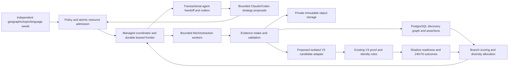

# Mycelium Phase 0 architecture review

**DRAFT r1 — 22 October 2026. Codex integrator; NOT YET JOINT. Design only.**

Authority: [Phase 0 commission](../../team/MYCELIUM_PHASE0_COMMISSION_2026-10-22.md). Existing incidents follow [the operational queue](../../team/CURRENT_EXECUTION_ORDER.md). This is one proposed architecture, not a new product version or permission to implement it. No runtime/producer code, migration, infrastructure, external crawl, paid/model call or host install has been executed for this design.

**Peer dependency:** Claude's commissioned `docs/mycelium/CLAUDE_DISCOVERY_DESIGN.md` was requested in the published22Oct claim `01879e5d`. It has not yet been received or reviewed. Existing Claude producer code and measured reports inform this draft; they do not constitute approval of this architecture. The final JOINT/AWAITING CHRIS APPROVAL state requires the contribution, actual cross-review and resolution or explicit recording of disagreements. Do not create that missing document in Claude's name.

## 1. Executive recommendation and reuse versus build

Recommend **a separately isolated discovery service using managed PostgreSQL and private content-addressed object storage**, with ordinary relational edges first. Benchmark it before selecting a provider. Keep existing V3 D1/R2, verification, customer reads, sign-in and billing in place. Mycelium proposes where to investigate; V3 remains the authority on identity, source facts and actionable opportunity eligibility.

The commercial hypothesis is that several bounded exploration methods, independent new seeds and measured branch feedback will find more **genuinely new event editions still verified and actionable at24h/7d per £ and worker-hour**, after withdrawals. More links, application variants or model conversations do not validate the hypothesis. A new recurring date exists only when the source proves a distinct occurrence; an inferred calendar expansion earns no credit.

**Three prerequisites:** reliable producer progress independent of transport heartbeats; benchmarked storage/lease recovery under realistic fan-out; and an executed unattended two-runtime handoff. None follows from writing this document. At12:25London22Oct, operational read-only checks found1708 customer READY/UK205, clear cloud queues, but no import after21Oct13:02 or source check after12:42London;1126 producer-scoped rechecks were pending. CJS47 are currently READY, but retained proof intervals cover the entire first24h for46; one crossed an expiry gap. This is not a captured exact-time customer snapshot. The observation used the existing private staging catalogue, original47-entity cohort, immutable verification intervals and structured delivery/status tables; private raw results stay out of Git. Operational repair remains ahead of design delivery.

| Reuse as a boundary/reference | Build only after approval | Do not replace |
|---|---|---|
| V3 immutable receipts, source clocks, identity decisions, verifier/readiness code, failure vocabulary and 100-row preservation control | Bounded discovery-candidate adapter with its own low-authority producer namespace and outcome interface | Existing customer/D1/R2 data, billing, public routes, V1/V2 |
| Producer parsers, country packs, safe source policies, retained evidence and export compatibility | Optional worker adapter to the coordinator; independent new-seed hypotheses and explicit relationships | Independent producer's `fdx1` identities or its current HTTPS delivery |
| Durable-job/fencing/outbox principles; existing Cloudflare queue infrastructure patterns | PostgreSQL discovery schema, branch/budget coordinator and configured unattended agent runners | Treating GitHub Markdown or ChatGPT as an automatic controller |
| Existing immutable experiment receipts and country/source scorecards | Delayed event-edition rewards, fair control allocation and cost/retention ledger | Counting new application IDs as new festivals |

**Why this candidate:** Postgres handles transactions, unique constraints, bounded graph joins and leases in one managed system. Objects keep large source bodies out of expensive relational indexes. D1 remains suitable for current V3; increasing its role to a globally expanding discovery graph would repeat the known capacity problem. A dedicated graph service is a fallback for measured traversal/analytics failures, not a prerequisite. Home hardware may provide bounded compute, never the sole authoritative database. If the bounded trial cannot improve retained-new-event yield over simpler source/verification improvements, reject the extra graph/coordinator rather than fund architectural novelty.

### Evidence inspected and limits

- [V3 source architecture](../findpitches-v3-architecture.md), [Worker routes](../../platform/findpitches-v3/worker.mjs), [producer authorities/normalisation](../../platform/findpitches-v3/contract.mjs), [verification and source clocks](../../platform/findpitches-v3/verification-store.mjs), [proof expiry/backoff](../../platform/findpitches-v3/source-renewal.mjs), [durable jobs](../../platform/findpitches-v3/jobs.mjs), and [source catalogue](../../platform/findpitches-v3/source-catalogue.mjs).
- [Producer ownership](../../producer/README.md), [frontier/assessment schema](../../producer/fp-discovery-lab/fpd/db.py), [exploration](../../producer/fp-discovery-lab/fpd/explore.py), [identity algorithm](../../producer/fp-discovery-lab/fpd/integration/identity.py), [export schema](../../producer/fp-discovery-lab/fpd/integration/schema.py), [cycle](../../producer/fp-discovery-lab/deploy/pi/bin/fpd-cycle), [systemd limits](../../producer/fp-discovery-lab/deploy/pi/systemd/fpd-acquire.service).
- Claude's [UK yield](../findpitches-v3-uk-producer-yield-2026-10-21.md):15648 weekly source pages, France52% of fetches for one then-READY, UK-specific generators about6%;232 delivered GB current IDs. Subsequent [cloud conversion](../findpitches-v3-localstalls-conversion-2026-10-21.md):8/232 producer IDs customer-ready. Different units/windows; neither is an intrinsic permanent source yield.
- [US learning](../findpitches-v3-us-learning-map-readiness-2026-10-14.md):68 source-proved entity gains but only two net new exact event groups; recent-window yield decayed and the arm stopped. The current official-operator extractor's zero platform leaves was not proof of zero opportunities.
- [Storage profile](../findpitches-v3-storage-plan-2026-10-14.md):7.91GB source documents in a9.63GB D1; [verified tiering](../findpitches-v3-storage-completion-2026-10-15.md) restored headroom without a rebuild. Later measured48h net D1 growth was114.5MB/day ([21Oct evidence](../../operations/findpitches-v3/reports/uk-growth-outcome-2026-10-21.json)). This is not a Postgres benchmark or a forecast of Mycelium savings.
- No Postgres deployment/query benchmark, provider quote, unattended Claude/Codex API round trip or current Pi shell measurement was performed. Calculations below are explicit planning assumptions.

## 2. End-to-end architecture

Objects are evidence, Postgres is discovery/control authority, V3 is eligibility authority. Transport queues wake a durable job; they do not own its state. No diagram arrow grants access to customer/billing data or enables publication. The experiment has no path into public customer reads.

**Two different branching operations:** workers discover event→organiser→venue→programme→application links with witnessed relationships; a bounded planner also proposes independent seed hypotheses from approved geographic/topic rosters and permitted strategy templates. Empty link-following must not halt discovery of new roots. Source text is untrusted data, never an instruction to invoke tools, change budgets or execute code. A model can propose a template instance, not deploy crawler code or grant a new credential/country/source policy.

**Initial source strategies, provisional pending Claude:** current platform application catalogues; official multi-event organisers and their venue programmes; municipal market/exhibitor calls and their actual forms/PDFs; association/directory pages used only to find official actors; independent geographic/topic seed expansion with English/French trader vocabulary. Existing `wikidata`, `osm`, directory and platform generators are reusable concepts, not automatic grants for their API credentials or access terms. Social/editorial/visitor-ticket pages can supply bounded discovery relationships but cannot prove an opportunity; policy may exclude them entirely from the pilot. FR is the only initial non-English sample. More languages/countries need supported export/verification semantics and a grant.

## 3. Common knowledge, evidence and handoff contract

### Data model and identity

| Relation | Required content and invariants | Interface owner |
|---|---|---|
| `subject`, `subject_alias` | UUID; type=actor/venue/event-series/edition/occurrence/application-route/document; literal names/language and namespace+native ID anchors. Aliases are claims with evidence, not merges. | Codex integrates; Claude supplies source anchors |
| `edition`, `occurrence`, `application_route` | Series relation; explicitly evidenced edition/date/session; source-specific native identity; separately typed route/state/deadline. UNKNOWN is permitted. A standing market listing is not automatically one dated edition or infinitely many occurrences. | Codex/V3 identity; Claude extracts evidence |
| `lead` | Exact URL/canonicalisation version, origin, registrable domain, language/country/topic **hints**, first/last observations, branch membership and policy disposition. Semantic query IDs retained; URL hash uniqueness is not real-event dedupe. | Claude worker contract; Codex schema |
| `edge`, `edge_evidence` | Typed directed relation, endpoints, source receipt/span, extraction version, confidence/uncertainty and validity observations. Includes discovers/organises/hosts/occurs-at/applies-via and possible-same-edition. Parent hypothesis may be an independent seed root. | Shared vocabulary; Codex arbitration |
| `assertion` | Append-only subject/predicate/value, original language, evidence receipt/span, parser version and source clock. Supersession is a new assertion with reason/parent; no destructive fact repair. | Codex custody; Claude extraction |
| `artifact`, `fetch_receipt` | Private object reference, raw-body SHA-256, envelope SHA-256, length, compression, media type, requested/final URL, access-policy version, actual fetched_at/status/redirect chain and fetch actor. One identical body can back several new immutable receipts. | Codex intake |
| `hypothesis`, `branch_event` | Root/parent, strategy+version, exact reason/evidence, country/language/topic scope, access policy, budgets, status, outcome and reopen condition. Append-only state-transition events. | Claude strategies; Codex state machine |
| `job`, `attempt`, `handoff`, `outbox`, `budget_reservation` | Deterministic idempotency key, dependencies, capability, fencing token, lease/deadline, resource grant and immutable result digest/attempt costs. | Codex coordinator |
| `v3_link`, `outcome_observation`, `experiment_assignment` | Immutable bridge request, producer ID, V3 entity/edition decision, proof revision/policy, actual READY/held/withdrawn observation and country/source attribution; root/arm/cost lineage. | Codex V3 and measurement |

V3's stable `ent_` identity and original producer `fdx1` IDs remain authoritative in their own namespaces. Mycelium graph IDs never replace them. A URL, translated name, same venue, shared form or model-suggested year cannot merge editions. Keep possible matches as edges until V3 makes an explicit identity decision. Several vendor forms for the same edition share one primary reward; distinct occurrence/edition evidence may earn a separate reward. Date/geography hints are never promoted to verified fields.

Raw source bytes and serialised custody envelopes have **different hash domains**; carry both algorithms/serialization versions explicitly. Existing R2 objects use the original serialized-document digest and clocks; do not reinterpret those keys as HTML-body hashes. New screenshots/PDFs are bounded byte objects with provenance, not scraped customer data. Do not copy whole source excerpts into every edge or job.

### Bounded worker and agent messages

A versioned request carries schema version; experiment/root/parent/branch/job/attempt IDs; required capability and strategy version; immutable input refs/digests; policy grant; allowed hosts/country-language hypotheses; redirect/depth/child/byte limits; HTTP/CPU/wall/model-token/cost ceilings; lease token+generation; deadline; expected output schema and callback audience. A result carries those correlations, original observations/evidence refs, proposed edges/assertions, errors/access refusals, proposed children, actual resource usage, result digest and partial/completed/uncertain disposition. No private API token, raw cookie, sign-in URL or customer email belongs in either message.

Same job key+same input/config/result digest replays idempotently. Same key+different payload is a conflict, not a silent update. Record lost responses and unknown provider spend; do not refund a reservation or blindly invoke a model again. Schema major versions reject incompatibility; parsers and hypothesis versions are explicit so replay does not masquerade as a fresh fetch. Claimed timestamps are checked against broker receipts and future clocks are rejected.

### Existing V3 API compatibility — a real gap

`POST /imports` currently **hard-codes `independent-structured`**, whose authority is100. `GET /rechecks` and exact-request `/rechecks/ack` belong to that scoped producer contract. Reusing its token/IDs for speculative Mycelium output would launder weak leads into the strongest lane and is rejected. The current catalogue discovery endpoints are operator-only and support bounded known platforms; they are not a general graph intake. Source-document upload OptionB remains off.

**Proposed later interface, not an existing route:** a separate authenticated discovery-candidate adapter, with Mycelium-only scope/ID namespace and no more than discovery authority50, validates provenance/idempotency and returns accepted/duplicate/held/rejected plus a durable receipt—not READY. Unknown or unsupported fields stay absent/held. V3's own direct-source verifier may then add stronger evidence under its normal rules; identity/country/date conflicts and original source selections remain protected. Unsupported source families stay WATCH, even if Mycelium extracted plausible facts.

Codex owns adapter/eligibility policy and an outcome read interface; Claude owns compatible worker/export metadata. Original Pi delivery remains logically independent and unchanged. The adapter requires future approved implementation and explicit isolation before it can receive anything. For the experiment, use V3 verifier/readiness code in an isolated test store with publication disabled and customer reads technically unable to include experiment IDs. Never rely on a client-provided shadow flag or accidentally import experimental records into today's public commercial scope.

## 4. PostgreSQL/object-store design and storage benchmark

### Physical design and operational constraints

Use a separate managed Postgres project/schema and a private Mycelium object prefix/bucket with distinct credentials; no existing V3 migration, table replacement or copy. Relational typed edges first. UUIDs identify internal rows; unique constraints cover namespace+native anchor, canonical URL hash+normaliser version, artifact digest, job dedupe key, and handoff result digest. Keep long URLs/labels in their owning row, not repeated in every edge. JSONB is for bounded extra attributes (target≤32KB), not raw pages or an unindexed graph dump.

Indexes: both `(from_subject, relation, to_subject)` and reverse edges; `(namespace, native_id)` anchors; unique canonical-hash lead index; branch/root/time outcome indexes; partial queued-job `(capability, available_at, priority, id)` and leased-job expiry indexes; per-domain cooldown/admission; object digest lookup. Do not index arbitrary JSON properties or personal contact text. Edge evidence has its own compact many-to-many references rather than repeating raw bodies.

Time-partition append-heavy attempt/fetch/outcome audit by month; keep frontier leases, budget counters and the global job/result/digest uniqueness registries small and unpartitioned initially. Do not assume a partition-local unique index enforces cross-partition idempotency; partition references carry their time key. Stable subjects/edges are not country-sharded: country can be disputed, and organisers cross borders. Benchmark hash partitioning the largest adjacency table only if its indexes/maintenance warrant it. Use short transactions for conditional lease claims and result+outbox+cost settlement, with `SKIP LOCKED`/fencing semantics; fetches/model calls never run while a database transaction is open. Autovacuum, dead tuples, WAL volume, index growth and replication lag are acceptance metrics, not hidden overhead.

Proposed pools:≤16 ordinary active DB connections initially, separate reserved operational connections; workers access scoped broker endpoints, not broad SQL credentials. Start with one fetch task/Pi and a measured memory ceiling, not the current config's generic concurrency16. Source systemd files declare550MB MemoryHigh/700MB MemoryMax and a2h cycle timeout; they do not establish present host settings/RSS. BRIX8GB machines are candidates only and remain idle; CPU/RAM/I/O throughput and reliable clocks must be measured after a separate grant. No browser-heavy or model-hosting assumption on the Pi. Cloud managed storage is authoritative if every home worker disappears.

### Explicit size model — estimates, not benchmarks

All GB/KB here are decimal. Let **L=retained URL leads**, not events. Base distribution per lead:

| Component | Assumed rows and mean attributed bytes | Logical bytes/lead |
|---|---|---:|
| Typed subjects | 1.5 ×512 | 768 |
| Lead metadata | 1 ×640 | 640 |
| Evidence-bound edges | 8 ×192 | 1536 |
| Compact assertions | 4 ×256 | 1024 |
| Representative fetch receipts | 2 ×224 | 448 |
| Artifact metadata | 1 ×256 | 256 |
| Compact job/outcome summaries | 0.5 ×256 | 128 |
| **Total** | Excludes source bodies | **4800** |

Assume **2× logical size** for heap/index/tuple/bloat allocation, to be replaced by measured `pg_total_relation_size`, and working disk≥1.5× that live size+5GB. Peak bulk-load WAL, backups, free space and replicas are additional provider constraints. Objects assume0.65 unique bodies/lead at60KB compressed, i.e.67.5% identical-body reuse across two receipts; this is a hypothesis, not measured compression/dedupe. Positive-proof history and repeated changes can exceed it.

| Retained leads | Subjects / edges | Logical PG | Modelled live PG | Candidate working disk | Primary objects |
|---:|---:|---:|---:|---:|---:|
| 100k | 150k /800k | 0.48GB | 0.96GB | ≥20GB provider floor | 3.9GB |
| 1m | 1.5m /8m | 4.8GB | 9.6GB | ≥20GB | 39GB |
| 10m | 15m /80m | 48GB | 96GB | ≥160GB | 390GB |

Sensitivity matters more than the neat base table. A3× instead of2× relational overhead makes the10m case144GB PG and at least221GB working disk before provider-specific limits. At10m leads,24 rather than8 edges adds **61.44GB PG** at the base overhead; eight rather than four assertions adds20.48GB. Three distinct200KB object versions/lead produce **6TB**, not390GB. At10k new leads/day, the base adds96MB PG and390MB primary objects/day before revisits/retention. Those numbers do not predict new READY or savings in existing D1. Log/attempt volume depends on fetch frequency, not just unique leads, so benchmark a separate10×-revisit case and a100k-edge hub.

### Retention, privacy and recovery

Proposed **new-service** policy for review: detailed transient fetch/worker logs14d; successful operational attempts30d; compact experiment/budget/outcome ledgers≥180d; deduplicated unqualified page bodies90d; small refusal/error bodies7d where permitted; durable discovery keys and compact claims retained until a reviewed archive policy applies. Keep every original evidence object relied on by an accepted V3 decision beyond those TTLs; GC must prove no proof/retention/legal-hold reference before removing anything. Repeated identical fetches add clocks/status, not another body. These policies do not delete, shorten retention or change existing V3 evidence, and deletion tooling is not authorised now.

Private encryption/access logs; no tokens/cookies/private attendee data/form submissions; minimise trader contact data and restrict access where a source necessarily publishes it. No cross-tenant content-addressed access/dedup without separate ACL ownership. Policy refusals and robots snapshots are durable small records so another agent cannot rediscover a blocked path as a novel strategy. Rights/deletion and legal-hold exceptions require a defined owner before launch.

Managed daily database snapshots+PITR7d (initial targets: RPO≤15min, RTO≤4h), plus approved separate-failure-domain backup of graph manifests and referenced immutable objects. Object-store durability is not a backup policy. A restore drill must validate all referenced hashes, retain grant/spend history and start dispatch OFF. Old leases/fencing generations and queued outbox delivery are invalidated before resuming, so restore cannot repeat model charges or page acquisition. Object version/lifecycle policies and backup egress costs need approval; no deletes or restore drills occur in Phase0.

### Cost ranges and database alternative

**Planning rates only, not current quotes:** PG provisioned storage£0.15–0.40/GB-month, backup£0.03–0.10/GB-month, object storage£0.01–0.03/GB-month/copy; request charges and cross-cloud egress may dominate repeated downloads. Assume an additional object backup copy and approximately2× live-PG backup bytes. Example provisioned compute/coordinator envelopes yield:

| Scale | Proposed compute / coordinator monthly allowance | Indicative service total/month |
|---|---:|---:|
| 100k | PG£40–100; coordinator£5–20 | about£50–130 |
| 1m | PG£90–220; coordinator£5–20 | about£100–260 |
| 10m | PG£250–700; coordinator£10–40 | about£300–850 |

Totals include the modelled disk/backup/object ranges, **exclude HA duplication, model/search, human review, large bandwidth/request bills and taxes**, and are not spending permission. Provider included storage/backups must not be double counted. Quote minimum billing, PITR/WAL, connection pooling, cold-start/fixed versus metered CPU, object GET/PUT, cross-region egress and caps before selection. If HA or10× revisit sensitivity exceeds the approved envelope, stop/re-scope rather than silently autoscale.

Model cost is separately visible: even one call/100 leads at an illustrative£0.02–0.20/call is£20–200 per100k leads and£2000–20000 per10m over the processing horizon, before any READY return. Those are assumed unit costs, not model quotes. Deterministic parsing/feedback first; scarce models plan/review branches or uncertain cases. Actual pinned-model token prices/FX and conservative reservations are required before any call.

**Postgres failure boundary:** high-degree hub expansion, hot global counters, large unbounded recursive paths, write-heavy evidence history, WAL/autovacuum/I/O churn or indexes exceeding memory can defeat the model. Cap traversals and per-domain work, measure amplification, and aggregate offline first. Consider a dedicated managed graph/analytics service only if representative bounded queries still fail after justified indexing/partitioning, or recurring deep traversals/community analytics become essential. Benchmark the same workload and full operational cost then; do not select it based solely on an edge-count threshold. SQLite on home hardware is a local cache, never the shared authority; D1 remains the current V3 boundary.

## 5. Real agent runtimes and durable coordinator

### What is actually available

| Component | Evidence now | Missing before unattended claims |
|---|---|---|
| Interactive Codex environment | This session can inspect the repo/cloud; a `codex` executable exists | No demonstrated machine-authenticated unattended invocation, configured trigger, supported API/CLI mode, provider billing/cost limit or resumable cross-session callback |
| Claude Cowork | Separate human-invoked session contributes producer code/status | No direct Pi shell per Claude; no evidenced unattended Claude runner, machine credential, callback identity, spend grant or end-to-end test |
| Pi services | Polling heartbeat verified; delivery/discovery source clocks have stalled | Host diagnosis, real installed version and work/result heartbeat; polling is neither successful export nor model-agent runtime |
| BRIX | Two8GB host candidates recorded as idle | Separate approval/install, enforced budgets, current clock/resource/soak evidence |
| Managed coordinator + Postgres | Proposed only | Approved provider, service credentials, event ingress, alarms/stop operator and executed recovery tests |

ChatGPT remains coordination/review; Hal provider configuration only if separately requested. Neither is a processing worker. GitHub is the human review/audit hub, not the hot queue. No new GitHub Actions, cron, notification bot, model key or automated agent is installed for this review.

Recommend a small managed coordinator colocated with Postgres for short transactions, with an outbox feeding an approved queue/HTTP wakeup transport. Reuse Cloudflare queue semantics where justified, rather than adopting a new queue product by default; a Worker-to-PG pooler/HTTP bridge must be benchmarked if chosen. Cloudflare's existing V3 queues/secrets are not automatically granted to this new service. Workers and two agent runners use separate short-lived scoped credentials/audiences, not shared operator or ingest credentials.

### State, claims and retries

| State | Admission/transition rule |
|---|---|
| PROPOSED | Parent/reason/evidence and immutable input exist; no I/O permitted |
| POLICY_BLOCKED / AWAITING_APPROVAL | Explicit access, credential, new scope, quota or human gate; model cannot override |
| QUEUED | Policy/grant valid; reserve worst-case request/byte/time/token/cost budgets atomically across job/root/run/hour/day/provider |
| LEASED / RUNNING | Single conditional claim increments fencing generation;5min lease,30s heartbeat, bounded hard deadline; target≤10min/job, smaller fetch tasks |
| WAITING_DEPENDENCY | Explicit DAG; max dependency depth8, no cycles; no long-lived held transaction or lease while waiting for another agent |
| RESULT_RECORDED | Validate input/version/fence/result digest; evidence complete; atomically persist result/outcome/cost/outbox |
| SETTLED | Durable acknowledgement; duplicate wakeup returns prior receipt without repeating work |
| RETRY_AT / DEAD | Up to3 bounded attempts with jitter/backoff; respect source Retry-After and negative policy cache; dead requires a recorded review/reopen event |
| SPEND_UNCERTAIN | Provider request may have run but outcome/bill is unknown; retain reservation, stop repeat invocation until provider reconciliation/operator review |
| PAUSED / PRUNED | Reason, evidence, budget spent, next eligible review condition; no identity/evidence deletion |

Every result uses lease generation/token plus input hash; a late worker can append an auditable late-attempt receipt but cannot overwrite an accepted result or schedule children. Broker dedupe prevents repeated effects, **not exactly-once external billing**. Lost model responses are not blindly retried unless the actual provider proves a safe idempotent resume. Failed/lost requests remain charged/reserved. Object write precedes DB reference; hash verification and result transaction make orphan cleanup possible only under a later approved policy. Outbox delivery after commit is at-least-once with dedupe; a periodic approved sweeper would recover lost wakeups. Store UTC event time and an explicit Europe/London budget day, enforce grant expiry across midnight/DST, and never reuse yesterday's unused grant for today's call. Releasing an expired unstarted reservation requires proof that no provider request was dispatched.

Separate progress signals: host contact, lease heartbeat, last completed job, source fetch, classification, full-export generation, delivery receipt, V3 verification and retained READY. Store why work stopped. Today's heartbeat-with-stale-export failure must be detectable even if every queue consumer is healthy. Existing status/hub surfaces should expose these aggregates; no new monitoring stack is required for Phase0.

Kill switch revokes new dispatch/child grants/model calls, preserves receipts and permits safe settlement/read-only recovery. Per-domain admission initially one concurrent request and≥2s delay, stricter policies taking precedence; shared broker enforces limits across all workers, redirects and V3 support fetches. Defend private-network/DNS rebinding/redirect SSRF; enforce response/expanded-byte/PDF/page/depth caps, robots/terms/privacy/permission policy and no login/challenge/form-submit bypass. Signed/private/one-use URLs are blocked and logged only as redacted hashes; permitted semantic platform IDs require a source-specific canonicaliser. Robots refusal never becomes exploration reward or an automatic alternate-client strategy.

### Model invocation and spending

Provider approval must identify an actual supported unattended OpenAI and Anthropic runtime, machine authentication, pinned permitted models, prompts/structured-output schema, supported cancellation/idempotency, billing ownership and licensing/terms. A CLI binary or human subscription is not proof. Runners have no shell/deploy/customer/billing rights, see only bounded cited source fragments, and cannot modify grants/prompts/tools in response to page instructions.

Ledger units: actual HTTP attempts/redirects/bytes, worker CPU seconds and leased active wall time, input/output/cache tokens, observed versus estimated provider charge, object operations/storage share and verifier/renewal overhead. Distinguish missing charges from zero. Reserve against verified provider prices with conservative currency conversion+20% buffer, reconcile actuals, and leave unknown spend reserved. Existing Serper4/run,100/hour,1000/day are unchanged; Mycelium paid-search budget defaults0 regardless of available credentials. Model and provider daily/root/run caps require their own grants. Every hypothetical model call has an owner and marginal expected retained-event value.

## 6. Selection, exploration and branch lifecycle

Allocate an initial **60% exploitation /25% exploration /15% independent new-root generation** of compute/request budgets, not candidate counts. Run several approved strategies concurrently within that global envelope. Enforce source-family/country/language/organiser caps before ranking so early US/Eventeny wins cannot consume everything. Proposed pilot allocation75%GB/25%FR; family≤50% and organiser≤15% of acquisition requests, with renewal obligations reserved separately. Unknown geography stays a hint and cannot satisfy verified country outcomes.

Branches carry prior, observations and a score snapshot/version; use a conservative posterior estimate/uncertainty bonus on **matured, attributable new-edition retention**, adjusted for expected cost, worker time and diversity. A small provisional reward for a source-proved candidate can prioritise proof, but may not be reported as commercial success. Mature24h and7d cohorts independently; do not label not-yet-due outcomes failures or reset a poor arm's denominator when a version changes. Record inherited evidence and parent cost when reopening a branch.

Attribution is edition-level, not every form/worker/path. Freeze baseline known event editions; V3 resolves uncertain identity. Known-edition new routes, recoveries and visibility-first-seen are secondary metrics. Shared causal paths retain multi-parent edges but earn at most one combined event credit; predeclare first-qualified-discovery or fractional attribution and report overlap/exclusive gains. Child/recheck/verification/retention costs roll into root and arm; unused budget is not a benefit. Track withdrawals of both acquired cohorts and baseline separately, including legitimate event expiry versus false promotion/operational proof gaps.

**Prune/pause rules:** explicit denial/unsafe content hard-blocks immediately; transient transport issues get bounded source backoff; two completed low-yield windows of20 verification decisions (after required outcomes mature),>70% duplicate editions in both windows, or empty extraction after500 charged discovery requests pauses that hypothesis. Keep a strict warm-up exception for tiny samples—no confident source-wide conclusions from one unsuccessful form. Early stop of discovery does not abandon already-admitted retention obligations. Reopen only on new cited source/template/edition/access evidence, a changed approved parser or a time-based source refresh condition; inherited failures/costs remain visible. No indefinite random recrawl of policy refusals.

Model proposals may generate genuinely new seed/relationship hypotheses within approved templates and rosters, including translated trader vocabulary. They cannot synthesise event facts, infer country from search terms or silently introduce an unsupported language/country/provider. Country packs must validate dates/relative years, negation, vendor-purpose, place names and application-window versus event-date distinctions. Original text stays immutable; machine translations have separate provenance and cannot outrank the source.

## 7. One bounded shadow experiment and measurement

**Proposed only, after Gates A/B below and an explicit pilot grant.** Freeze V3 verifier/identity versions and existing known-edition baseline. Compare existing V3 source-led selection as control against Mycelium branching/independent-root allocation. No broad city-search lane; paid-search0. Use a reviewed, policy-eligible seed registry stratified by GB/FR, source family and event horizon. Randomise matched organiser/domain clusters to arms to reduce shared-source contamination; record assignment before acquisition and show baseline imbalance. A paired retained-document replay first ensures identical evidence yields identical V3 decisions in both arms. Small sample conclusions remain directional, not proof of scalable uplift.

| Bound, per arm unless stated | Proposed value and purpose |
|---|---|
| Scope | GB75% / FR25% acquisition requests;≥20 reviewed organiser/domain clusters per arm where available; do not infer verified country from quota |
| Time | Acquisition≤48h; follow each admitted cohort through t0+24h and+7d; report by day10, hard experiment stop day14 |
| HTTP | ≤6000 physical-attempt-equivalent grants/arm including robots/redirect/support docs:1200 discovery,1200 first proof,3000 retention,600 reserve; combined≤2500/day, no budget increase without operator change |
| Other resource caps | ≤1500 graph leads/arm,60 edition-verification attempts,≤50 READY-edition cohorts admitted for funded7d renewal,12 active worker-hours/arm, source-body≤2.5MB/PDF≤5MB under policy, link-depth3/≤20 children per task |
| Models | Proposed separate combined≤£10/experiment and≤20 calls; pinned-token limits/grants first; deterministic paths continue only within their own budget |
| Concurrency | Initially one task/Pi;≤4 cloud workers/arm if explicitly granted and benchmarked; no BRIX required or enabled by this plan |
| Isolation | New evaluation store/namespace; same V3 proof/identity code, publication/customer access disabled; seed/calibration leakage excluded from measured holdout |

The planned retention allowance supports roughly50 daily eight-read bundles for7d/arm, not unlimited renewals. More expensive sources require fewer admissions, not a budget bypass. All budgets include failures and request redirects; no direct-source bulk launch now. If an operation cannot reserve its worst-case remaining support/retention cost, do not start it. Shared broker coalescing is logged: shared receipts retain the actual source clock, logical observations are recorded per arm and physical costs are allocated once with an explicit shared-cost rule. Independent background V3 maintenance is reported separately, never counted as experiment discovery or silently deducted from only one arm.

### Outcomes and stops

Primary funnel: seeds→fetched sources→unique candidate editions→source-verified→shadow V3 READY→READY at24h→READY at7d; separately new, matched-existing, new route, recovered, duplicate, uncertain and withdrawals. Calculate attributable **net retained new editions/£** and **/active worker-hour**, with absolute gross gains/losses beside any ratio. For each fixed cohort, retained-new equals first-READY new editions minus that same cohort's withdrawals once; do not subtract withdrawals again from an already-retained count. Whole-catalogue net equals all gains minus all withdrawals in the same unit/window, with recoveries/new routes and baseline losses separately attributed. Zero/unknown costs or denominators return undefined, not infinite yield. Report country/language/source/organiser/venue mix, actual human review minutes, false promotions, immutable-source/identity changes, queue ages, proof gaps and paid queries0. An independent reviewer audits every claimed new READY edition and a predeclared stratified held sample against retained evidence, including event/edition identity, country, dates, venue, organiser, trader route/state and provenance; self-scoring is insufficient. Reviewer identity/capacity/cost must be approved before the pilot, not assumed to be free human labour.

Observe READY at the actual target time with source evidence valid then; delayed observation must be labelled delayed, with proof/history coverage limits. Also report continuous proof-supported availability so a record that disappeared and recovered cannot be presented as uninterrupted24h retention. Event/deadline horizons are pre-stratified: imminent opportunities may naturally expire before7d and need a separate short-horizon view, not removal from the denominator after the result is known. Distinct exact-field groups are advisory; ambiguous semantic duplicates require review before new-event credit.

Immediate stop for evidence/identity mutation, any customer/Free privacy leakage, prohibited access, unbounded task fan-out, unknown provider charges, grant breach or source integrity failure. Pause new discovery if verification backlog>40 or oldest due proof>30min, budget/politeness limits are reached, or no source-proved candidate after40 completed verification decisions. A matured zero-READY cohort or two low-yield/duplicate windows pauses the arm; preserve evidence and funded observation duties. No candidate-count success claim.

Proposed evidence for a further pilot, not a guaranteed result:≥10 genuinely new UK editions READY at24h,≥5 still actionable in the predeclared7d horizon group, at least two independently productive source families,0 wrong/unsafe promotions in an independent audit,0 evidence/identity mutation or leakage, and better retained-event cost/worker yield than control without worse diversity. Report confidence intervals/cluster sizes and failures; small results authorise no autonomous scale-up. An unsupported verifier family or inaccessible non-English sample is a failed prerequisite to review, not a reason to make the gate permissive.

## 8. Phase 0A and 0B implementation plans — NOT EXECUTED

### 0A: storage/workload benchmark plan

After approval only, build an isolated disposable test dataset of100k/1m/10m leads with the distributions above, high-degree hubs, repeated bodies, conflicting edition anchors, mixed languages and a10× revisit/failure case. Use synthetic non-customer data plus a small approved private source-shape calibration set; do not export live customer/identity databases or fetch new external sites. Record seed, dataset/loader versions, native query plans, row/index/TOAST/WAL sizes, heap bloat, object compression/dedup, CPU/RSS/I/O, load/restore time and actual provider cost. No benchmark has run yet.

Proposed baseline4vCPU/16GB managed PG, bounded pooling, warm/cold caches and1/5/20 concurrent clients;50 only as a recorded overload test. Test URL/native-ID dedupe; compact assertion/edge insertion; short leased-job claim/heartbeat; fenced result+outbox+budget settlement; reverse and two-hop neighbourhood≤200 nodes/1000 edges; capped three-hop exploration; current branch/outcome reads; object round-trip/hash failure; dead-letter replay; worker/network loss and managed backup restore. No unbounded all-graph walk.

Proposed p95 targets at the agreed20-client workload: canonical/native-ID lookup≤50ms, lease claim≤100ms, DB-only result settlement≤250ms, bounded two-hop neighbourhood≤500ms, with0 lost/duplicate committed effects or accepted stale-fence writes. These are test targets, not measured SLOs. Sustain≥100 short lease/result transactions/s for30min; keep hard connection/memory/capacity limits and record failure, rather than scaling to force a pass. Explicitly measure normal source-style traffic as well as COPY/bulk ingest; fast bulk loading is not proof of online traversal performance.

Spend proposal **≤£75 total/≤24h managed-resource window**, including all minimum charges/storage/backups/request costs, with no model/API crawling. Provider pricing/cap visibility must make that enforceable before provisioning; otherwise stop for a different approved envelope. Start100k, then1m;10m execution requires the same grant to cover peak disk/WAL/backup and remaining time, otherwise publish a projection and request a distinct measured tranche. No provider chosen, account created, dependency installed, database purchased or infrastructure deleted. Test-resource shutdown/decommission must follow the specifically approved lifecycle; no effect on V3.

### 0B: genuine two-runtime handoff plan

After separately approved machine runtimes/credentials and **≤£5 total,≤6 model calls,≤20 broker jobs,≤30min**, submit synthetic policy-safe job A to the real Codex runner. Codex returns a schema-valid source-strategy critique/evidence refs; coordinator records it and dispatches job B to the real Claude runner. Claude returns a disagreement/revision referencing A; a final real Codex invocation acknowledges/reconciles B. Three calls remain as a strictly bounded fault allowance, not permission for uncertain-spend re-invocation. No external crawl, source mutation or live deployment tools are available to either runner.

Acceptance: event trigger works with the human UI closed; authenticated actor identities and correlated provider request IDs/costs; durable result digests and cross-agent references; replayed wakeup produces no repeated invocation; worker kill/lease expiry and stale callback cannot duplicate settled effects; a simulated lost provider response enters SPEND_UNCERTAIN; dead-letter/recovery and OFF switch preserve audit; actual billing reconciles within caps. A document acknowledgement, mocked provider, two replies from the same model identity or a human copy/paste is not this proof. Tests consume no calls before an explicit grant.

If only one supported unattended runtime is available, publish that blocker and stop the cross-agent claim. An approved deterministic single-controller alternative can later be compared, not silently substituted for the commissioned two-agent proof.

## 9. Open decisions, cross-review and approval gates

### Numbered decisions and unresolved risks

| ID | Decision / concrete missing evidence | Owner and proposed default |
|---|---|---|
| Q1 | Claude source/worker contribution and actual review: strategies, memory limits, source policies, feedback and export mapping | Claude contributes exact commissioned file; Codex integrates and records disagreements; missing now |
| Q2 | Managed provider/region, object-store locality, pooling, backup/PITR/egress/minimum charges and cost cap | Chris approves after comparable quote/workload assumptions; PG+private objects is a benchmark candidate only |
| Q3 | Retention/privacy/backup rights and source-policy ownership, including published trader contacts and deletion exceptions | Chris product/data authority; do not apply proposed TTLs to V3 |
| Q4 | Actual independent unattended Codex/Claude runtimes, credentials, billing owner, allowed tools/models and cancellation/idempotency | Chris grants; Codex/Claude validate supported provider mechanisms; currently unproved |
| Q5 | New V3 candidate producer/authority/schema and experiment isolation; standing market versus dated edition mappings | Codex proposes low authority50; Claude reviews source compatibility; no existing token reuse |
| Q6 | Explicit 0A/0B expenditure and resource lifecycle; later pilot model/request/worker budget | Chris approves each phase; suggested£75/£5 are unspent ceilings, not grants |
| Q7 | Success floor,24h/7d/horizon/attribution rule and acceptable retained-event cost/worker-hour for commercial scale | Chris/ChatGPT product review; use proposed gates above until deliberately revised |

Unsolved technical risks: freshness can stall while heartbeats pass; global graph/hub growth and revisits can exceed storage assumptions; producer standing IDs may not map cleanly to source-proved editions; model strategy churn can reset apparent performance; small language samples can hide false positives; provider cancellation cannot guarantee unbilled work; current V3 lacks a generic low-authority graph intake; access/robots restrictions may remove apparently attractive source families. These are acceptance/approval dependencies, not permission to broaden the build.

### Concrete cross-review request to Claude

Please write **only** the commissioned `docs/mycelium/CLAUDE_DISCOVERY_DESIGN.md` when operational host work permits. Review this single proposal against: (1) independent seed strategies versus link-following and FR vocabulary; (2) actual Pi/BRIX worker memory/concurrency without assuming host access; (3) failure/duplicate/retention feedback and reopen rules; (4) preserving `fdx1` standing/edition identity while Mycelium claims only low-authority leads; (5) real unattended-runtime prerequisites and the 0B proof. Name concrete disagreement with task fields, budget, source policy or experiment design. Do not begin a worker kit or request hands-on Pi work for Phase0.

**Acknowledgements/conflicts so far:** Codex has used Claude's actual UK yield findings and producer source: source count/actionable labels are not customer eligibility; the SQLite frontier already supports bounded exploration and should not be rebuilt as a competing producer. The producer's standing LocalStalls identity and event-edition KPI require an explicit mapping rather than identity rewriting (Q5). Its current exporter/known-country enums and V3 `/imports` authority do not permit generic global lead delivery as-is. No fresh Claude contribution/cross-review or Claude acknowledgement of this draft has been observed; no resolution or JOINT claim is fabricated.

### Gates and stopping point

1. **Design gate:** complete Claude contribution/cross-review in the two exact documents; Codex resolves or records conflicts, publishes one JOINT review marked AWAITING CHRIS APPROVAL, and requests a decision on Q1–Q7. No implementation before that approval.
2. **0A gate:** explicit provider/resource/budget/data-lifecycle approval; isolated storage benchmark only. No live migration.
3. **0B gate:** explicit independent-runtime/credential/model-spend/tool approval; synthetic two-way proof only. No crawling.
4. **Pilot gate:** approved evidence from0A/0B, source policy, country pack, candidate adapter/isolation and fixed budget/control design; then a bounded shadow experiment only. Failure leaves the existing producer/V3 intact.
5. **Scale gate:** independently audited retained-new-event/cost/diversity results and reliable operational freshness; Chris decides any next scope/budget/hardware/production exposure. No self-authorised unrestricted paid acquisition or publication.

**Not being built:** a V4, customer/billing/SEO/maps/paywall redesign, V1/V2 migration, a new France repair programme, shared Pi SQLite database, graph provider deployment, autonomous model scheduler, new keys, paid crawler, BRIX installation or alert/notification system.

**STOP: this draft authorises no implementation.** First obtain the missing Claude contribution/cross-review; only then present the concrete joint review to Chris and request explicit approval before any 0A/0B or later implementation/spend.
